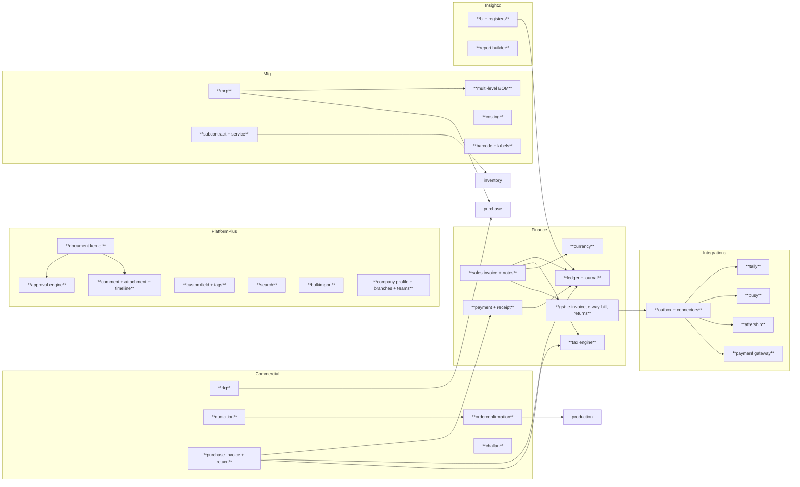
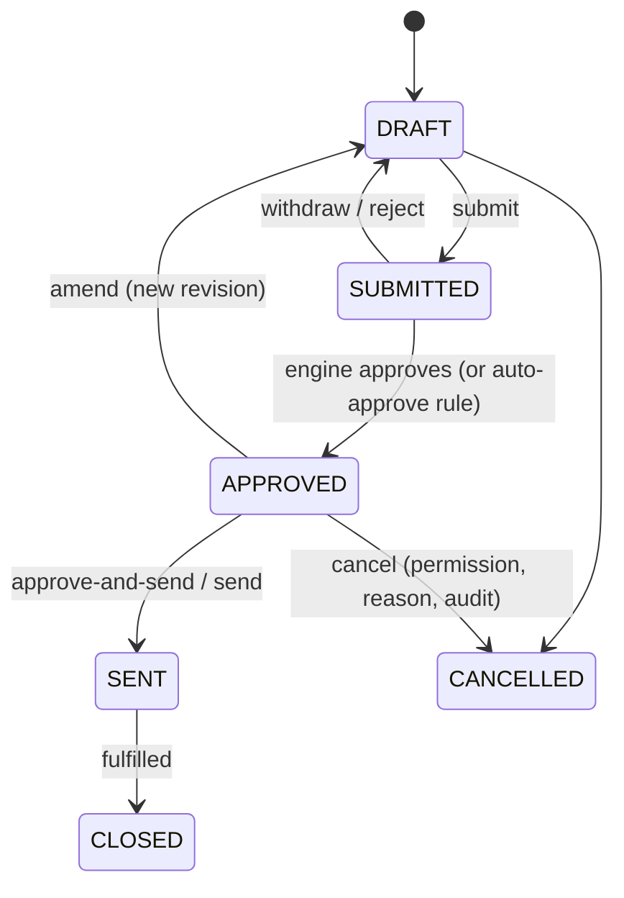
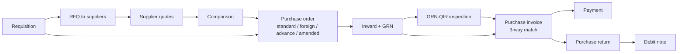
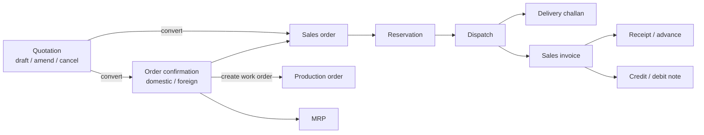
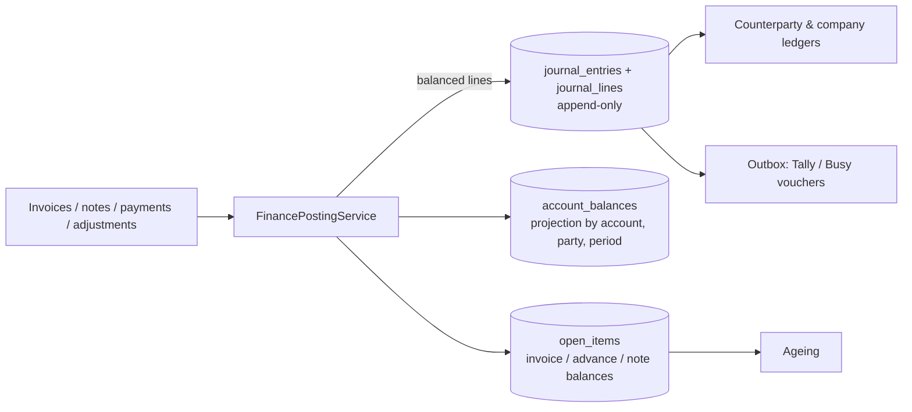
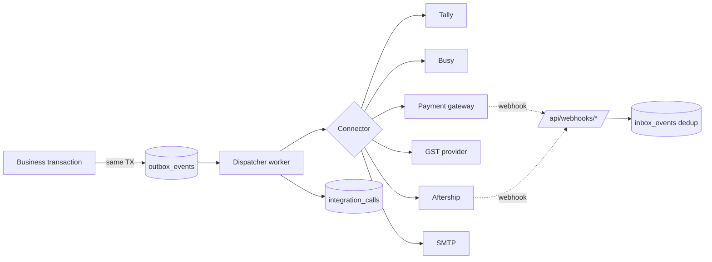

# ARCHITECTURE-ERP.md — Full ERP Extension

**Status:** addendum to `ARCHITECTURE.md`. Additive only. Every principle, module, ADR (01–16) and rule in `ARCHITECTURE.md` and `CLAUDE.md` still applies. This file adds modules and mechanisms for Phases 9–17 (`PLAN-ERP.md`) that implement `REQUIREMENTS-ERP.md`. Schemas, algorithms and contracts are in `DESIGN-ERP.md`.
**Where they disagree:** `ARCHITECTURE.md` wins for the inventory spine; this file wins for ERP modules. Anything not covered here must be raised as a design question, not guessed.

## Contents
1. Goals and principles · 2. Module map · 3. Document framework · 4. Approval engine · 5. Platform services (custom fields, comments, attachments, timeline, search, bulk import) · 6. Purchase architecture · 7. Sales architecture · 8. Finance architecture · 9. Tax and currency · 10. E-invoice and e-way bill · 11. Manufacturing extensions (multi-level BOM, MRP, costing) · 12. Barcodes and labels · 13. Sub-contract and service · 14. BI and report builder · 15. Integration framework · 16. Security additions · 17. Multi-company and multi-GSTIN · 18. Performance and data volume · 19. Frontend additions · 20. Testing · 21. Deployment and operations · 22. ADRs 17–30 · 23. Traceability to requirements

---

## 1. Goals and principles

| # | Principle | Consequence |
|---|---|---|
| E-1 | **Two posting spines, never mixed.** Stock moves only through `InventoryPostingService`. Money moves only through `FinancePostingService`. | A document that has both effects (purchase return, dispatch with invoice) calls both services in one transaction; neither service writes the other's tables. |
| E-2 | **Reuse the document kernel.** Every business document (RFQ, quotation, OC, invoice, challan…) is built on the same header/line/status/approval/series/attachment/timeline framework (§3). | New documents cost days, not weeks; behaviour is uniform. |
| E-3 | **Immutable once posted.** Posted invoices, journal entries and ledger rows are never edited. Corrections are credit/debit notes or reversals. | Same philosophy as ADR-11, extended to money. |
| E-4 | **Data-driven compliance.** Tax rates, place-of-supply rules, TDS sections, document series and number resets are rows with effective dates, not code. | A rate change is a data migration with a test, not a release. |
| E-5 | **Integrations are asynchronous and replayable.** External calls go through an outbox with retries, a call log and an idempotent adapter. | A Tally or GSP outage never blocks a user transaction. |
| E-6 | **Extend, never rewrite.** Existing tables get new nullable columns or new tables; existing endpoints keep behaviour; existing workflows are moved onto new engines behind the same API. | CLAUDE.md rule 4. |
| E-7 | **One company, many GSTINs first.** `company_id` stays in every table; a `company_branches` table carries GSTIN and state (§17). | Multi-company becomes a configuration change later (decision E7). |
| E-8 | **Backend authorizes everything**, including the report builder (§14). | 403 rule unchanged. |

---

## 2. Module map

New modules (bold) added to the map in `ARCHITECTURE.md` §4.1. Packages live under `com.springmfg.ims`.

**Dependency rules (enforced by ArchUnit, added in Phase 9):**
- `document`, `approval`, `customfield`, `attachment`, `search`, `bulkimport`, `tax`, `currency` are **foundation** modules. They may depend on `common` and on each other only as drawn; they depend on no feature module.
- Feature modules (`rfq`, `quotation`, `orderconfirmation`, `challan`, `salesinvoice`, `purchaseinvoice`, …) depend on foundation modules and on `inventory`/`finance` services, never on each other's repositories.
- `finance` (ledger, journal) depends on nothing above it; invoices and payments call it.
- `integration` modules depend on the `outbox` and on published events; no business module depends on an integration module.
- `bi` and `reportbuilder` read through read-only views and never write.

---

## 3. Document framework (`document` module)

Purpose: give all commercial documents identical structure and behaviour.

| Concern | Mechanism |
|---|---|
| Header + lines | Each document type has its own tables (strong typing, constraints), but implements `Document` / `DocumentLine` interfaces and shares `DocumentTotals` (§9) and `DocumentSeries`. No generic "documents" table. |
| Numbering | `DocumentSeriesService` replaces direct use of `DocumentNumberService`: series are rows (prefix, format, reset policy, branch, financial year, manual/auto). Existing prefixes are migrated as default series rows (ADR-19). |
| Status | Per-document `StateMachine` as in `DESIGN.md` §4.4. `allowedActions[]` returned in every response (existing pattern). |
| Revisions / amend | `revision_no` plus `root_document_id`. Amend creates a new revision in DRAFT; the previous revision becomes SUPERSEDED but stays readable. Posted financial documents cannot be amended (E-3). |
| Copy / convert | `DocumentConverter<S,T>` beans (quotation→OC, OC→work order, RFQ→PO, PO→GRN…). Each records `document_links(source_type, source_id, target_type, target_id)` so the timeline and traceability can walk the chain. |
| Approval | Document submit calls the approval engine (§4); the machine transition `SUBMITTED→APPROVED` is performed only by the engine callback. |
| Comments, attachments, timeline | Polymorphic by `(entity_type, entity_id)` (§5). |
| Custom fields, tags | Same polymorphic key (§5). |
| Print | One PDF template per document type, rendered from a view model with company branding (logo, signature, bank, T&C). Templates are versioned files plus a per-type selector row (decision E8). |
| Concurrency | Optimistic locking on documents (ADR-03); stock/ledger writes pessimistic. |

Lifecycle for any document:

Each document type narrows this (e.g. invoices add POSTED and have no return to DRAFT).

---

## 4. Approval engine (`approval` module)

Replaces the fixed steps of `ApprovalService` with **rules**, without breaking existing callers.

- `approval_rules(document_type, condition, steps…)`: conditions are evaluated on a document snapshot (amount, supplier, branch, currency, category, requester team). Evaluation is a small, safe expression language (field, operator, constant, AND/OR) stored as JSON — no scripting.
- Outcomes: **auto-approve**, **manual** (ordered steps, each by permission, by role, or by team), or **parallel** (any-of / all-of at a step).
- Actions: approve, reject, **approve-and-send**, **withdraw** (requester only, while pending), re-submit, cancel/amend an approved document (creates a new approval cycle).
- Safeguards carried over: requester cannot approve own request (`SEGREGATION_OF_DUTIES`); approver must hold the step's permission; decisions are audited with comment.
- History: `approval_requests` (existing) gains `rule_id`, `cycle_no`, `step_group`; all decisions remain queryable per document (`/approvals/history`).
- **Compatibility:** existing workflows (PO, stock adjustment, BOM) are registered as built-in rules reproducing today's steps (including the adjustment threshold). Their APIs and permissions do not change. Migration is a data insert plus a service swap behind `ApprovalService` (ADR-18).

---

## 5. Platform services

### 5.1 Custom fields and tags (`customfield`)
- `custom_field_definitions(entity_type, code, label, data_type, required, options, show_on_print, order)` define fields per entity type (item, customer, supplier, each document).
- Values stored as JSONB `custom` on the entity (new nullable column) — same technique as spring specs (ADR-06), with the definitions as the validation catalogue. Indexed with GIN where filtered.
- Tags: `tags(name, colour)` and `entity_tags(entity_type, entity_id, tag_id)`; filterable in all list endpoints through the shared Specification builder.
- Permissions: `CUSTOMFIELD_MANAGE`; values follow the permission of the entity.

### 5.2 Comments, attachments, timeline (`attachment`)
- `comments(entity_type, entity_id, visibility INTERNAL|EXTERNAL, body, author, created_at)`. EXTERNAL comments are included in e-mails/PDF sent to the counterparty; INTERNAL never are.
- `attachments(entity_type, entity_id, file_name, content_type, size, sha256, storage_key, uploaded_by)`. Bytes live in a `FileStore` interface: local volume implementation first (`/data/files`, backed up), S3-compatible implementation later (ADR-20). Upload limits and content-type allow-list are settings; files are virus-scanned through an optional ClamAV hook; downloads go through the API (permission-checked), never direct paths.
- **Timeline** is not a table. It is a view assembled from `audit_logs` (state changes), `approval_requests`, `comments`, `attachments`, `document_links` and outbox deliveries for the entity, ordered by time. This avoids a second write path.

### 5.3 Global search (`search`)
- Postgres full-text plus `pg_trgm` (already installed in V0.1) over a `search_index(entity_type, entity_id, title, body_tsv, branch_id, permission_code, updated_at)` table.
- Updated by domain events (`DocumentChanged`) in the same transaction (small row) — no external search engine in v1 (ADR-21).
- Query results are filtered by the caller's view permission per entity type (`permission_code`) and by warehouse/branch scope. Never return a hit the user could not open.

### 5.4 Bulk import (`bulkimport`)
Pipeline: **upload → parse (xlsx/csv) → map columns → validate (dry run) → report → commit**.
- Each importable entity registers an `ImportDefinition` (columns, validators, `upsert` strategy, permission). Masters, items, BOM, suppliers/customers use the same service layer as the UI (no direct SQL), so all validation and audit apply.
- Opening stock and opening balances post through `InventoryPostingService` and `FinancePostingService` (opening journal), never by table insert.
- All-or-nothing per file by default; row-level error file (xlsx) is downloadable. Large files run as async jobs (§18) with progress.
- `import_jobs` records file hash, counts and result; re-uploading the same file with the same hash is rejected unless forced.

### 5.5 Company profile, branches, teams (`org`)
- `company_profile` (legal name, logos, signatures, default T&C, default payment terms), `company_branches` (GSTIN, state code, address, series scope), `bank_accounts`, `transporters`, `payment_terms`, `terms_templates`.
- `teams` and `team_members`; teams scope visibility and notifications and may be a target of approval steps. Team permissions are an additional grant layer *intersected* with role permissions for report access (`team_report_access`); they never grant write rights that roles do not already allow.
- `notification_preferences(user_id, event_type, channel IN_APP|EMAIL, enabled)`.

---

## 6. Purchase architecture

- **RFQ:** one RFQ → many supplier invitations → quotes entered per supplier per line. Comparison is a query (landed price = rate × FX + freight + tax effect). "Award" converts selected quote lines into one or more POs through `DocumentConverter`.
- **PO variants** are attributes, not new tables: `po_kind` (STANDARD, FOREIGN, ADVANCE), `currency`, `exchange_rate`, plus `po_revisions` (amendment history) using the §3 revision mechanism. PO advance creates a payable *advance* in finance (§8), cleared when the invoice is matched.
- **GRN-QIR:** the existing incoming inspection (`ARCHITECTURE.md` §6.2) is linked from the GRN; QIR is its printable report.
- **Three-way match:** purchase invoice lines reference `po_item_id` and `grn_item_id`. Rule: invoiced qty ≤ received (accepted) qty within tolerance, rate within price tolerance; mismatch raises a `MATCH_EXCEPTION` and blocks posting unless a user with `PURCHASE_INVOICE_OVERRIDE` approves with a reason. Mismatch lists feed the "GRN-invoice mismatch" register.
- **Purchase return:** stock out through `InventoryPostingService` (new transaction type `PURCHASE_RETURN`, ADR-22), then a **debit note** through finance. Both in one transaction.
- Accepted-quantity cost flows into inventory valuation at invoice posting through a cost adjustment (§8.5) so moving-average cost reflects landed cost.

---

## 7. Sales architecture

- **Order confirmation vs sales order:** an OC is the customer-facing commitment (prices, terms, delivery, currency). A sales order (existing) is the internal fulfilment document. Confirming an OC creates/links exactly one sales order (1:1) so that reservation and dispatch code is untouched (E-6). Orders created directly as sales orders remain valid.
- **Work order from OC:** creates a production order in DRAFT per product line (using the then-active BOM), links back through `document_links`, and writes `sales_order_item.production_order_id`. Releasing still snapshots the BOM (ADR-10).
- **Delivery challan:** types RETURNABLE (job work, samples, demo), NON_RETURNABLE (sale in transit), SERVICE. It is a stock-moving document only when type and settings say so; dispatch against an order posts stock once — a challan that accompanies a dispatch references it, it does not post a second time.
- **Dispatch communication:** after dispatch, "send dispatch details" renders the PDF (existing) plus transport info and e-mails it through the outbox (§15); delivery tracking via Aftership updates the dispatch's tracking status.
- **Credit/debit notes** are finance documents (§8) that may reference a dispatch return; a sales return posts `CUSTOMER_RETURN` stock (existing type) and a credit note.

---

## 8. Finance architecture

### 8.1 Scope decision (decision E1)
Design target: a **lightweight double-entry sub-ledger inside IMS**, because ageing, receivables/payables, counterparty ledgers and GST reports require balanced, auditable postings. It is deliberately *not* a full general ledger product: chart of accounts is small and mapped; statutory financial statements remain in Tally/Busy. If E1 resolves to "external books only", the same journal still feeds the connectors and nothing is thrown away.

### 8.2 Components

- **`FinancePostingService.post(JournalCommand)`** is the only writer of `journal_*`, `account_balances`, `open_items`. Validates: debits = credits (to the paisa), period open, accounts active, currency rates present, idempotency key. Locks affected `account_balances` rows ordered by id (same technique as ADR-03).
- **Journal rows are append-only** with DB triggers blocking UPDATE/DELETE (same as the stock ledger, ADR-11). Reversal = a new entry with swapped sides and `reverses_entry_id`.
- **Accounts:** small chart (`accounts`): Receivables, Payables, Sales, Sales-Export, Purchases, Inventory, GRNI (goods received not invoiced), Output CGST/SGST/IGST, Input CGST/SGST/IGST, TDS payable/receivable, TCS, Bank, Cash, Advances received/paid, Discounts, Round-off, Forex gain/loss, Freight. **Account determination** is a table (`account_mappings`: event type × tax code × branch → account), so no account number appears in code.
- **Open items:** every invoice/note/advance creates an open item; payments *allocate* against open items (`payment_allocations`), supporting one payment → many invoices and many payments → one invoice, and advance receipts applied later.
- **Periods and lock:** `fiscal_periods` with OPEN/CLOSED; posting into a closed period fails with `PERIOD_CLOSED`.
- **Reconciliation job:** nightly: Σ journal = Σ balances; each invoice's open-item balance = total − allocations − notes; AR/AP control accounts = sum of open items; report to alerts (`FINANCE_MISMATCH`) like the stock ledger job.

### 8.3 Document-to-journal events
| Event | Debit | Credit |
|---|---|---|
| Sales invoice posted | Receivables (gross) | Sales, Output taxes, Round-off |
| Credit note (sales) | Sales / Output taxes | Receivables |
| Receipt against invoice | Bank | Receivables |
| Advance receipt voucher | Bank | Advances received (+ output tax if applicable) |
| Goods received (inventory cost) | Inventory | GRNI |
| Purchase invoice posted | GRNI, Input taxes | Payables (gross); TDS payable on deduction |
| Payment to supplier | Payables | Bank |
| Purchase return debit note | Payables | Inventory/GRNI, Input taxes |
| Forex difference at settlement | Forex loss / Receivables | Receivables / Forex gain |

Costs on the stock side stay in the inventory ledger (moving average). GRNI bridges the two: the inventory spine values goods at receipt using PO rate; invoice posting adjusts any rate variance through a `COST_ADJUSTMENT` on the balance without a quantity change (ADR-23).

### 8.4 Sales/purchase invoices are immutable once POSTED
Statuses: DRAFT → (APPROVED) → POSTED → (PARTIALLY_PAID → PAID) / CANCELLED(by credit note only, or within e-invoice cancel window as policy). PROFORMA invoices are a distinct kind that never posts to the journal and never consumes a statutory series.

### 8.5 TDS/TCS
Tax deducted/collected at source is modelled as tax lines of type TDS/TCS on the document or payment, with `tds_sections` (section, rate, threshold, effective dates). `tds_entries` records deduction, deposit challan, and certificate reference. Threshold tracking is per party per fiscal year.

---

## 9. Tax and currency (`tax`, `currency`)

- **Tax engine** is a pure function: `TaxCalculator.calculate(lines, partyStates, taxRegime, date) → TaxResult` with no I/O besides cached rate tables. Inputs: HSN/SAC per item, supplier/customer GSTIN state, **place of supply**, supply type (B2B, B2C, export, SEZ, deemed), reverse-charge flag. Output per line: taxable value, CGST/SGST or IGST (or none for export under LUT), cess, rounding.
- **Rates are data:** `tax_rates(hsn_sac_prefix, rate_cgst, rate_sgst, rate_igst, cess, effective_from, effective_to)` and `tax_codes`. Documents store the rate *used* on each line so later rate changes never alter history.
- **Rounding policy** (documented, tested): line-level tax rounded half-up to 2 decimals; document round-off to nearest rupee as a separate line; money columns hold 4 decimals internally.
- **Currency:** `currencies`, `exchange_rates(currency, date, rate_to_inr, source)`. Documents in foreign currency store `currency`, `exchange_rate`, `amount_foreign`, `amount_inr`. Rate choice per decision E3 (manual / daily import / per transaction). Settlement computes forex difference automatically (§8.3).
- **Export invoices:** under LUT (zero-rated, no IGST) or with IGST payment (refund route); shipping bill, port code and incoterm captured as fields.

---

## 10. E-invoice and e-way bill (`gst`)

- Two output modes, both always available:
  1. **JSON export** in the government schema (downloadable for manual upload).
  2. **API generation** through a `GstProvider` interface (GSP). Implementations are plug-ins; credentials in the secret store. Until decision E2 resolves, only the JSON mode and a sandbox stub exist.
- State on the invoice: `einvoice_status` NOT_REQUIRED, PENDING, GENERATED, FAILED, CANCELLED, with IRN, acknowledgement number/date, signed QR. Generation is requested via the outbox; success stores IRN/QR and the invoice PDF is re-rendered with the QR. Failure keeps the invoice POSTED with a clear status and retry.
- **Eligibility** (turnover threshold, B2B only, exemptions) is a settings-driven rule.
- **E-way bill:** triggered from dispatch/invoice when consignment value exceeds threshold; Part-A from invoice, Part-B from transporter details (vehicle). JSON export and API as above; extend validity and cancel supported only through the provider interface.
- **GST returns:** GSTR-1 (B2B/B2C/exports/notes), GSTR-3B summary, HSN summary, and ITC reconciliation views are reports over the journal and tax lines with JSON/Excel export in the portal schema. Filing itself is out of scope; the files are produced for upload.
- All GST artefacts are reproducible from stored data; nothing is generated that cannot be re-created.

---

## 11. Manufacturing extensions

### 11.1 Multi-level BOM (`bom` extension)
- `bom_items` gain `component_kind` (MATERIAL, SUB_ASSEMBLY) and `child_bom_id`/`child_product_id`. Sub-assemblies are products with their own ACTIVE BOM.
- **Explosion** is a recursive CTE with cycle detection (a cycle is rejected at BOM approval) and quantity multiplication including scrap allowance. Output is a flattened, level-annotated list.
- **Alternate items:** `bom_item_alternates(bom_item_id, alternate_material_id, ratio, priority, valid_from/to)`. MRP and issue allocation may substitute by priority when the primary is short; every substitution is recorded on the issue.
- **Cost check:** rolled-up cost = Σ(component cost × qty) + routing cost (machine rate × standard time), using costing policy per component (latest PO, moving average, or standard). Shown in BOM view with a staleness date.
- Release still **snapshots the exploded BOM** into the order (ADR-10); sub-assembly lines can be produced via child production orders linked by `parent_production_order_id` (make-vs-buy flag on the BOM line).

### 11.2 MRP (`mrp`)
Inputs: demand (selected finished goods and quantities, or an OC/sales order), on-hand and reserved stock by status, open POs (expected receipts), open production orders (expected outputs), min/reorder levels, lead times, alternates.
Algorithm (detail in DESIGN-ERP §4.6): net requirements by level, lot-sizing (as-is, fixed multiple, min order qty), lead-time offsetting, supplier selection (preferred / last price). Output is an **MRP run** (immutable result set) with *suggestions* — planned purchase requisitions and planned production orders — that a planner reviews and converts through `DocumentConverter`. MRP never creates stock movements and never writes PO/production orders without a user action.
Negative quantities in the result are treated as data errors and listed in an exceptions section (negative on-hand cannot occur by rule 1; negative net means surplus and is shown as such) — this answers the "negative quantities in MRP" troubleshooting item.

### 11.3 Costing (`costing`)
- Material cost: moving average from the existing balances.
- Conversion cost: machine/operation rates × actual time (from operation execution) + labour rate if configured.
- **FG cost** = materials consumed (actual, from `MATERIAL_CONSUMPTION`) + conversion cost + allocated scrap loss; stored on the FG batch at completion (`fg_batches.unit_cost`) and used as the inventory value of the `PRODUCTION_RECEIPT`. Variance vs standard is reported.
- **Process log:** read model over operation events (start/pause/resume/complete, downtime, rejections, who/when) presented per order.

---

## 12. Barcodes and labels (`label`)
- Code formats: **Code128** for batch/item numbers, **QR** (payload = signed short URL token + type + id) for batch labels. Label templates (size, fields, symbology) are rows; rendering produces PDF or ZPL for thermal printers.
- Printing is browser/PDF first (no print server). A `LabelService.render(template, entities[])` API is the only entry point.
- Scanning: the frontend uses `BarcodeDetector` or a JS fallback library through the device camera, and wedge scanners as keyboard input; scan resolves via `/api/scan/{code}` to an entity and allowed actions for the user. Used by stores for issue/receipt/transfer/count entry.

---

## 13. Sub-contract (job work) and service orders

- **Location, not mechanism.** Stock at a vendor is a `SUBCONTRACT` location type per vendor (new value of `location_type`), so the existing ledger, balances, valuation and traceability work unchanged (ADR-24).
- Flow: **Job-work order** (process, expected output, rate/charge) → **issue materials** (`SUBCONTRACT_ISSUE`: store → vendor location, with returnable challan) → **receive output** (`SUBCONTRACT_RECEIPT`: vendor consumption + output, scrap, shortage) → **job-charge invoice** (purchase invoice with service lines and TDS) → close. Material balance at vendor = issued − consumed − returned − scrap, shown per vendor.
- **Service orders / confirmations:** service items (`item_kind = SERVICE`) have no stock effect. A service order has a confirmation step (accepting delivery of service), which feeds the invoice match in place of a GRN. Sales-side service documents work symmetrically.
- Quality inspection of received job-work output reuses incoming inspection.

---

## 14. BI and report builder

- **Semantic layer:** a curated set of SQL **views** (`bi_sales`, `bi_purchase`, `bi_inventory`, `bi_production`, `bi_quotation`, `bi_accounts`) exposing dimensions (date, party, item, category, branch, team, status) and measures. BI dashboards and registers are defined as JSON `ReportDefinition`s over these views; heavy aggregates use materialized views refreshed by the existing scheduler.
- **Custom report builder** lets permitted users compose reports from the whitelist: choose a view, fields, filters, grouping, sort, aggregation, chart type. The server translates the JSON to SQL with **parameter binding and identifier whitelisting only**; there is no free SQL, no joins beyond the views, a hard row limit, statement timeout and read-only DB role. Saved reports have an owner and share scope (private, team, role).
- **Data permissions:** every view column carries a `permission_code`; a field the user may not view is not offered and is rejected if submitted. Branch/warehouse scoping is applied as a mandatory predicate. Team report permissions (§5.5) decide which saved reports a user can run.
- **Exports** reuse the report framework (Excel/CSV streaming, PDF, async for large sets, export audit — `ARCHITECTURE.md` §14.1).
- **Aggregate view** combines area dashboards for management; role-aware widget sets from DESIGN §9.1 are extended, not replaced.

---

## 15. Integration framework (`integration`)

- **Transactional outbox** (the "outbox later" of ADR-14 arrives here, ADR-25): a row is written in the same transaction as the business change; a dispatcher delivers with exponential backoff, a max-attempt cap, dead-letter status, and manual retry. Delivery is **at-least-once**, so every connector call is idempotent (idempotency key = outbox event id).
- **Connector contract:** `Connector<C extends ConnectorConfig>` with `test()`, `deliver(event)`, and optional `pull()`. Config and secrets per connector instance in `integration_connections`; secrets encrypted with an application key from the environment (AES-GCM), never returned by the API, never logged.
- **Inbound webhooks:** public paths, authenticated by signature (HMAC) or provider token, de-duplicated via `inbox_events`, never trusted for authorization decisions beyond their narrow purpose.
- **Tally:** push model — IMS generates Tally XML vouchers (sales, purchase, receipt, payment, journal, credit/debit note) and ledger masters from the journal and master data, sends to Tally over HTTP (TDL-less XML import) or produces files for manual import. *Rules* map IMS events to Tally voucher types and ledgers (`tally_rules`). Approval gate: vouchers wait in `PENDING_APPROVAL` until approved, then flow to the outbox; missing ledger → exception state with an explanation and a "create ledger" action (answers the "missing ledger during Tally approval" troubleshooting item). A small **TDL extension** and a **browser/desktop helper** are optional deliverables for sites where Tally is not reachable by HTTP; data extraction (pull of ledgers/vouchers for reconciliation) uses the same XML interface.
- **Connection modes (decision E5: Tally Prime on a separate PC → helper first):** server-to-Tally over HTTP (not built first), a Chrome (Manifest V3) **browser helper** that pushes approved vouchers to Tally on the user's own PC (the default when IMS is hosted in the cloud and Tally is not reachable from it), or file download. The helper is a thin, permission-minimal client of IMS endpoints; vouchers remain idempotent via the IMS Document Id UDF supplied by the TDL extension (DESIGN-ERP §4.13.1).
- **Busy:** file/API export of masters and vouchers in Busy's import format; same rule/approval model as Tally.
- **Aftership:** create trackings from dispatch (courier, tracking number), receive status webhooks, update dispatch tracking status and notify the customer-facing user.
- **Payments:** payment gateway adapter creates payment links/orders for invoices, receives success webhooks, and posts a receipt through finance with reconciliation against the gateway settlement report.
- **Observability:** `integration_calls` (request summary, response status, duration, correlation id) with retention; an Integrations admin screen shows queue depth, failures and replay.

---

## 16. Security additions

| Topic | Design |
|---|---|
| New permissions | Added by migration only (e.g. `QUOTATION_*`, `INVOICE_*`, `PAYMENT_*`, `JOURNAL_VIEW`, `PERIOD_CLOSE`, `GST_FILE_EXPORT`, `INTEGRATION_MANAGE`, `REPORT_BUILD`, `BULK_IMPORT`). Catalogue in DESIGN-ERP §6. Default role mapping extends the 13 roles; new roles (Accountant, Accounts Manager, Sales Executive/Manager, Purchase Executive/Manager) are optional data rows. |
| Segregation of duties | Creator ≠ approver ≠ poster for invoices and payments (configurable); payment run approval separate from payment entry. |
| Financial data | Ledger/finance screens and exports require explicit permissions; operators never see prices or margins. Cost and price fields are field-level protected (`COST_VIEW`, `PRICE_VIEW`) in all DTOs. |
| Secrets | Integration credentials encrypted at rest, rotation supported, redacted in logs/audit. |
| Uploads | Allow-listed types, size caps, hash stored, served with `Content-Disposition` and `X-Content-Type-Options: nosniff`, never executed or rendered inline from user content. |
| Report builder | Whitelist, binding, timeout, row limit, read-only role, audit of every execution and export. |
| Webhooks | Signature verification, replay window, rate limiting, no sensitive data in responses. |
| Audit | New audited actions: invoice post/cancel, payment, allocation, journal reversal, period close, tax-rate change, approval rule change, integration config change, report export, bulk import. |
| Data protection | Customer/supplier contact data minimised in logs; GSTIN/PAN validated and treated as business identifiers; retention settings for attachments and integration logs. |

---

## 17. Multi-company and multi-GSTIN
- `company_id` already exists everywhere. Phase 9 adds `company_branches` (GSTIN, state, address, series) and a `branch_id` on documents that need it (sales/purchase invoices, challans, e-way bills, series).
- Place of supply, tax split and document series resolve per branch.
- Users are scoped to branches via `user_branch_access` (similar to `user_warehouse_access`).
- True multi-company (separate books, inter-company) is **not** implemented; decision E7. All unique business keys remain unique per `company_id` already in indexes added from V12 onward (`UNIQUE (company_id, code)`), so enabling it later is additive.

---

## 18. Performance and data volume

| Table family | Expected growth | Strategy |
|---|---|---|
| `journal_lines` | highest finance volume (≈ 4–8 lines per document) | partition by month on `entry_date`; indexes on (account_id, party_id, entry_date); `account_balances` projection for reads |
| `open_items` | one per open document | partial index on `balance <> 0`; ageing queries read only this |
| `integration_calls`, `outbox_events` | per event | retention job (e.g. 90 days delivered), partition by month |
| `search_index` | one row per searchable entity | GIN on tsvector, trigram on title |
| `attachments` | metadata small; bytes on file store | store by hash, de-duplicate, quota setting |

- **Async jobs:** a `jobs` table plus a bounded thread pool (`JobRunner`) for imports, large exports, MRP runs, e-invoice batches and report builder exports; one backend instance first (single scheduler lock via PostgreSQL advisory lock keeps schedulers safe if scaled).
- **Caching:** tax rates, exchange rates, series and permissions cached in-process with explicit invalidation on change; never cache balances.
- **Targets (extend DESIGN §13.4):** invoice post p95 < 300 ms for 50 lines; MRP run for 500 FG × 3-level BOM < 30 s; ageing for 50k open items < 2 s; global search p95 < 300 ms.

---

## 19. Frontend additions
- **New feature areas** (lazy routes, permission-guarded): `sales` (quotations, OC, invoices, challans, notes), `purchase` (RFQ, quotes, PO variants, invoices, returns), `accounts` (payments, ledgers, ageing, TDS, GST), `planning` (BOM explorer, MRP), `subcontract`, `bi`, `settings` (series, custom fields, approval rules, tax, company, integrations).
- **Shared components added:** `DocumentShell` (header, status chip, allowed actions, timeline/comments/attachments tabs), `LineGrid` (editable lines with totals and tax breakup), `PartyPicker`, `ItemPicker` (with barcode scan), `MoneyInput`/`CurrencyPill`, `ApprovalPanel`, `ImportWizard`, `ReportBuilder`, `BarcodeScanButton`, `LabelPrintDialog`, `AgeingChart`.
- **Totals are shown by the UI but always computed by the server** (E-8 / existing rule): the line grid previews with the same tax rules from a read-only `/tax/preview` endpoint.
- **Tablet/mobile:** operator and store screens keep large-target design; scan-first flows for stores.
- **State:** signals + services per feature (unchanged); no global store.

---

## 20. Testing additions
- **Finance:** property tests (random document sequences keep Σdebits = Σcredits, open items = invoices − allocations); golden-file tests for tax with accountant-supplied worked examples; rounding tests; period-close tests; reversal tests.
- **Approval engine:** rule evaluation matrix; compatibility tests proving existing PO/adjustment/BOM flows behave exactly as before.
- **MRP:** fixtures with known answers (multi-level, alternates, lot size, lead time).
- **Integration:** connector contract tests with recorded fixtures; outbox retry/idempotency tests; webhook signature tests. Real sandboxes are verified by the user (cloud build environments cannot reach vendor sandboxes).
- **Report builder security:** injection suite (identifiers, values, order-by), permission leakage, limit enforcement.
- **Import:** malformed files, partial failure, duplicate upload, large file.
- **ArchUnit:** extend with the new dependency rules (§2) and "only `FinancePostingService` writes journal tables".
- **Regression guard:** the Phase 0–8 suites run unchanged in every ERP phase CI.

---

## 21. Deployment and operations
- Same single backend image; add a **file volume** (`/data/files`) and optional `clamav` service; optional `worker` profile running the same image with `ims.jobs.worker=true` when load grows.
- New environment variables (documented in `.env.example`): `FILE_STORE_PATH`, `INTEGRATION_KEY` (secret-encryption key), `GSP_*`, `TALLY_*`, `PAYMENT_*`, `SMTP_*`. None are committed.
- Backups include the file volume; restore drill covers DB + files (Phase 17).
- Migrations remain Flyway, additive, numbered after V11 (DESIGN-ERP §1.3). Large back-fills (series migration, search index build) run as post-migration jobs, not inside the migration transaction.
- Feature flags (`ims.features.*` in settings) allow shipping a phase dark and enabling it after UAT.

---

## 22. Architecture Decision Records (ERP)

| ADR | Decision | Rationale | Alternatives rejected |
|---|---|---|---|
| 17 | **Separate finance posting spine** (`FinancePostingService`, append-only journal) | Same integrity guarantees as stock; reconciles independently | Writing money columns directly from documents; mixing with the stock ledger |
| 18 | **Rule-based approval engine behind the existing `ApprovalService`** | Meets configurable approvals without breaking Phase 2–4 flows | Rewriting existing workflows; hard-coded per-document steps |
| 19 | **Document series as data; existing prefixes migrated as default series** | Required resets/manual numbering/branch series; backward compatible | Hard-coded formats |
| 20 | **`FileStore` abstraction, local volume first** | Simple to run; S3 later without code change | Blobs in PostgreSQL; direct S3 now |
| 21 | **Postgres FTS + trigram for global search** | No new infrastructure; permission filtering in SQL | Elasticsearch/OpenSearch in v1 |
| 22 | **New ledger type `PURCHASE_RETURN`** (additive to ADR-04's pattern) | Distinguishes supplier returns from adjustments in traceability and reports | Using STOCK_ADJUSTMENT |
| 23 | **Inventory valued at receipt, invoice variance posted as `COST_ADJUSTMENT`; GRNI account bridges** | Standard accrual treatment; keeps quantity ledger untouched | Revaluing by editing ledger rows |
| 24 | **Stock at vendor is a location type** | Reuses ledger/valuation/traceability | Separate job-work stock tables |
| 25 | **Transactional outbox + idempotent connectors** | Reliable async integration | Calling external systems inside user transactions |
| 26 | **Data-driven tax (rates, sections, rules with effective dates)** | Compliance changes without releases | Hard-coded GST logic |
| 27 | **Report builder over curated views with whitelisted identifiers** | Safe user-defined reports | Free SQL; exposing base tables |
| 28 | **Custom fields as JSONB + definition catalogue** | Reuses ADR-06 pattern; no EAV | EAV tables; schema change per field |
| 29 | **MRP outputs suggestions only (immutable runs)** | Auditable, reviewable planning; no silent document creation | Auto-creating POs/orders |
| 30 | **GST e-invoice/e-way bill through a provider interface, JSON export always available** | Works before provider decision; no vendor lock-in | Direct integration with one GSP |

---

## 23. Traceability to REQUIREMENTS-ERP

| Requirement | Architecture section |
|---|---|
| ERP-A-1, A-2, A-3 | §3 (series), §5.5, §9 (UOM in DESIGN-ERP) |
| ERP-A-4, A-5, A-9 | §5.1, §5.2, §5.3 |
| ERP-A-6, A-7 | §4, §5.5 |
| ERP-A-8 | §5.4 |
| ERP-B-1…4 | §6, §8 |
| ERP-C-1…4 | §7, §12 (labels on challan), §15 (dispatch mail/tracking) |
| ERP-D-1…9 | §8, §9, §10 |
| ERP-E-1…5 | §11, §12 |
| ERP-F-1, F-2 | §13 |
| ERP-G-1…3 | §14 |
| ERP-H-1…4 | §15 |
