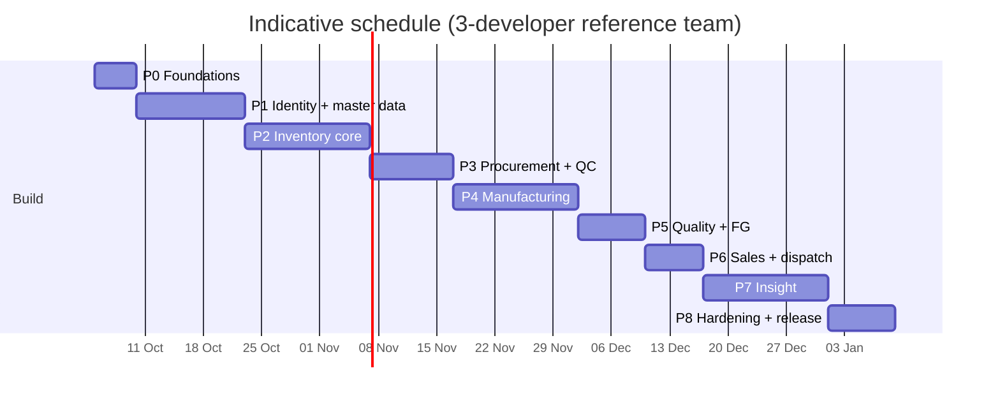
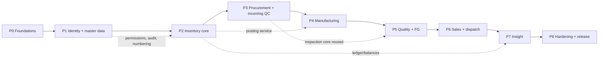

# PLAN.md — Configurable Manufacturing ERP Platform

**Version:** 2.0  **Date:** 2026-10-02
**Inputs:** REQUIREMENTS.md v2.0 (what) · ARCHITECTURE.md v2.0 (structure) · DESIGN.md v2.0 (detail)
**Purpose:** the execution plan — releases, tasks, estimates, dependencies, quality gates, and the order of work. Each task points to the exact DESIGN.md / ARCHITECTURE.md section it implements.

> Document map: REQUIREMENTS = *what* · ARCHITECTURE = *structure* · DESIGN = *detail* · **PLAN = *order, effort and gates*.**
>
> **Platform note:** Releases R1–R8 deliver the Spring Manufacturing (v1) configuration of the platform. The universal Core ERP, Manufacturing and Common Services layers are built once and reused by all future industry verticals. Releases R9–R20 expand the platform into a full SAP-class ERP. R20 adds additional industry verticals solely through seed data migrations.

## Contents
1. Planning Basis and Assumptions
2. Release Summary and Milestones (R1–R20)
3. Working Agreements (Definition of Ready / Done)
4. Phase 0 — Foundations [Complete]
5. Phase 1 / R1 — Identity, Security and Master Data [Complete]
6. Phase 2 / R2 — Warehouses and Inventory Core [Complete]
7. Phase 3 / R3 — Procurement and Incoming Quality [Complete]
8. Phase 4 / R4 — Manufacturing [Complete]
9. Phase 5 / R5 — Quality and Finished Goods [Complete]
10. Phase 6 / R6 — Sales and Dispatch [Complete]
11. Phase 7 / R7 — Insight: Dashboards, Reports, Alerts, Traceability [Complete]
12. Phase 8 / R8 — Hardening and Release [Complete]
13. Release 9 — Finance (FIN)
14. Release 10 — Controlling (CTR)
15. Release 11 — MRP
16. Release 12 — CRM
17. Release 13 — HR Management (HRM)
18. Release 14 — Warehouse Management (WMS)
19. Release 15 — Product Lifecycle Management (PLM)
20. Release 16 — Advanced Quality (QMS+)
21. Release 17 — Document Management and Notifications
22. Release 18 — Advanced Manufacturing (OEE, Scheduling)
23. Release 19 — Analytics and Integration
24. Release 20 — Industry Verticals
25. Dependency Map (R9–R20)
26. Risk Register
27. Quality Gates and Metrics
28. Requirements Coverage Matrix (R1–R20)
29. Building with Claude Code (AI-assisted protocol)
30. Command Cheat Sheet
- Appendix A — Requirements Traceability Matrix (every REQUIREMENTS clause → PLAN task; authoritative coverage view)

---

## 1. Planning Basis and Assumptions

| Item | Assumption |
|---|---|
| Scope | Everything in REQUIREMENTS.md v1.1, delivered in the seven phases it prescribes, plus a Phase 0 (foundations) and Phase 8 (hardening/release). Phases 0–8 build the Spring Manufacturing (v1) vertical of the Manufacturing ERP Platform; the universal layers (Core ERP, Manufacturing, Common Services) are the primary deliverable — the Spring configuration is seed data on top. |
| Order | **Each phase is finished completely (backend + migration + Angular + tests + seed + docs) before the next starts.** No placeholders or TODOs carried forward. Work *inside* a phase can be parallel (backend / frontend / tests). |
| Team (reference) | 3 developers (2 backend-leaning, 1 frontend-leaning, all comfortable across the stack), part-time QA and DevOps support, product owner available for decisions and UAT |
| Effort unit | person-days (pd). Estimates include unit/integration tests, code review and documentation for the task |
| Capacity | ~12 effective pd/week for the reference team (3 devs × 5 days × 80% focus) |
| Start date | Monday 5 Oct 2026 (indicative) |
| Change policy | Additive-only: never edit an applied Flyway migration, add a new `V#` file; extend APIs by adding fields/endpoints rather than changing behaviour |
| Estimates | planning estimates (±25%). Re-baseline after Phase 1 using actual velocity |

If a single engineer is building with an AI coding assistant, the same task list and gates apply; see §18. Effort in that case is dominated by review, testing and decisions rather than typing, so measure velocity on Phase 1 before committing to dates.

---

## 2. Schedule Summary and Milestones

| Phase | Name | Effort (pd) | Duration | Indicative dates | Milestone gate |
|---|---|---|---|---|---|
| 0 | Foundations | 8 | 1 wk | 5 – 9 Oct | **M0** pipeline green, stack runs via Docker |
| 1 | Identity, security, master data | 28.5 | 2.5 wk | 12 – 28 Oct | **M1** login + RBAC + master data demo; 403 matrix passes |
| 2 | Warehouses and inventory core | 32 | 3 wk | 29 Oct – 18 Nov | **M2** ledger-based stock, batches, approved adjustments |
| 3 | Procurement and incoming quality | 20 | 2 wk | 19 Nov – 2 Dec | **M3** PO → GR → inspection → stock works end to end |
| 4 | Manufacturing | 35.5 | 3 wk | 3 – 23 Dec | **M4** BOM → order → issue → operations → WIP → FG pending |
| 5 | Quality and finished goods | 17.5 | 1.5 wk | 24 Dec – 5 Jan | **M5** final inspection gates FG stock; rejections tracked |
| 6 | Sales and dispatch | 14.5 | 1.5 wk | 6 – 14 Jan | **M6** sales order → reservation → dispatch reduces stock |
| 7 | Insight | 32.5 | 3 wk | 15 Jan – 4 Feb | **M7** dashboards, reports, alerts, traceability, audit viewer |
| 8 | Hardening and release | 15.5 | 1.5 wk | 5 – 17 Feb | **M8** UAT signed off, release candidate |
| | **Total** | **204** | **~19 wk** | **5 Oct 2026 – ~17 Feb 2027** | |

Festival and holiday days (for example Dussehra and Diwali) fall in Phases 1–2; confirm the company calendar and add 3–5 days if the team is unavailable. The 20% focus factor in the capacity figure already covers meetings and ordinary interruptions, not extended leave.



### Milestone demonstration map (steps from DESIGN.md §12)
| Milestone | Demonstrable steps of the 22-step workflow |
|---|---|
| M1 | 19 (Operator gets 403 on `PUT /api/products/{id}`), 22 (Management read-only) |
| M2 | 18 (stock adjustment with approval and audit) |
| M3 | 1 – 5 (PO, receipt into quarantine, quarantine blocked, inspection accepts) |
| M4 | 6 – 12, 17 (BOM, order, issue, operations, WIP, FG pending, close) |
| M5 | 13 – 14 (FG not approved until inspection; partial approval) |
| M6 | 15 – 16 (reservation, dispatch, over-dispatch refused) |
| M7 | 20 – 22 (traceability both ways, dashboards) |
| M8 | all 22 steps automated and green |

---

## 3. Working Agreements

### 3.1 Definition of Ready (task may start)
- Task references the section of DESIGN.md/ARCHITECTURE.md it implements.
- Any decision it depends on (§14) is resolved or has a documented default.
- Acceptance criteria are listed in the task or in the phase gate.

### 3.2 Definition of Done (task is finished)
- [ ] Code merged via pull request with at least one review
- [ ] Unit/service tests written; repository tests run against real PostgreSQL (Testcontainers)
- [ ] Every new endpoint: `@PreAuthorize`, request/response DTOs, OpenAPI annotations, ProblemDetail errors with stable `code`
- [ ] Business rules from REQUIREMENTS §6 relevant to the task have a failing-then-passing test
- [ ] Stock-changing code goes only through `InventoryPostingService`
- [ ] Sensitive actions write audit records
- [ ] Flyway migration added (never edited after merge), seed/reference data updated
- [ ] Angular: typed service, component, form validation, permission handling, loading/error states, unit tests
- [ ] CI green (build, tests, lint, ArchUnit, dependency scan)
- [ ] Documentation updated (README/API notes/ADR if a decision changed)

### 3.3 Branching and commits
- Trunk-based with short-lived branches: `feature/P2-2.3-posting-service`.
- Conventional commits (`feat:`, `fix:`, `test:`, `docs:`, `chore:`); task id in the subject.
- Pull request template includes the Definition of Done checklist and the DESIGN section implemented.
- Squash merge; `main` always releasable and deployable via Compose.

### 3.4 Phase exit gate (applies to every phase)
1. All phase tasks done per §3.2.
2. Phase acceptance criteria demonstrated (milestone demo, §2).
3. Integration workflow tests for the phase pass in CI.
4. Role × endpoint 403 matrix regenerated and green for all endpoints that exist so far.
5. ArchUnit rules green (layering, no unprotected endpoints, only the posting service writes stock).
6. Seed/demo data loads cleanly on an empty database and the demo steps for the phase run.
7. README setup instructions verified on a clean machine (or clean container).
8. Retrospective: update estimates and risks in this plan.

---

## 4. Phase 0 — Foundations (8 pd)

**Goal:** a runnable, tested, deployable skeleton so every later phase starts from green.
**Prerequisites:** repository access, decisions §14 items 1–3 raised with the product owner.

| ID | Task | Deliverable | pd | Ref |
|---|---|---|---|---|
| 0.1 | Monorepo layout, `.gitignore`, `.editorconfig`, licence, README skeleton | `/backend /frontend /docker /docs`, root README | 0.5 | ARCH §16 |
| 0.2 | Backend skeleton: Spring Boot 3, Java 17+, Maven, package structure, profiles (`dev`,`test`,`prod`), Flyway baseline, `BaseEntity`+auditing, `GlobalExceptionHandler` (ProblemDetail), springdoc, Actuator, logback JSON + correlation id | app starts, `/actuator/health` and Swagger UI respond | 1.5 | ARCH §4 |
| 0.3 | Frontend skeleton: Angular 18 standalone, Angular Material theme, shell layout (sidebar, top bar), lazy route structure, interceptor skeletons, `environment`/runtime config | `ng serve` shows empty shell | 1.5 | ARCH §13, DESIGN §8 |
| 0.4 | Docker: multi-stage Dockerfiles (backend JRE slim non-root, frontend nginx), `docker-compose.yml` + dev/prod overrides, Postgres 16 with healthcheck and volume, MailHog (dev) | `docker compose up` brings the whole stack up | 1 | ARCH §16 |
| 0.5 | CI pipeline: build, unit tests, Testcontainers integration tests, ArchUnit, ESLint/Prettier, `npm audit`, OWASP dependency-check, image build, Compose smoke test | green pipeline on `main` and PRs | 1.5 | ARCH §17 |
| 0.6 | Test infrastructure: `AbstractIntegrationTest` (Testcontainers), data builders, JWT test helper, Playwright skeleton | sample tests passing | 1 | DESIGN §13 |
| 0.7 | Engineering conventions: `CONTRIBUTING.md`, PR template with DoD, ADR folder seeded with ADR-01…14, code-style config | docs committed | 0.5 | PLAN §3 |
| 0.8 | Decision workshop: confirm or default the §14 blockers | decisions logged in `docs/decisions.md` | 0.5 | PLAN §14 |

**Exit gate M0:** `docker compose up` yields reachable frontend, API, Swagger and DB; CI green; one trivial end-to-end test passes.

---

## 5. Phase 1 — Identity, Security and Master Data (28.5 pd)

**Goal:** secure foundation: users, roles, permissions, JWT, audit skeleton, and the master data every other module references.
**Prerequisites:** Phase 0; decision #11 (Belleville/Custom attributes) at least defaulted.
**Migrations:** V1, V2 (partial), V3.

| ID | Task | Deliverable | pd | Ref |
|---|---|---|---|---|
| 1.1 | Migrations V1–V3: schema, UOMs, IAM tables, settings, number sequences, audit (partitioned), suppliers, customers, materials, products, spring specs, attribute definitions | applied cleanly on empty DB; schema validated by Hibernate | 2 | DESIGN §2.1–2.3 |
| 1.2 | Reference seed: 13 roles, full permission catalogue, role→permission map, rejection reasons, standard operations, default settings | seed migration; test asserts the matrix equals DESIGN §7.1/ARCH §10.3 | 1.5 | DESIGN §7.1, §11.1 |
| 1.3 | Authentication: login, JWT (15 min), rotating refresh in HttpOnly cookie, lockout, BCrypt(12), password policy + history, forgot/reset by e-mail, rate limiting on `/api/auth/**` | `/api/auth/*` endpoints with tests | 4 | ARCH §10.1, DESIGN §5.1, §7.2 |
| 1.4 | Authorization plumbing: `JwtAuthenticationFilter`, permission cache with `permission_version`, `@PreAuthorize` conventions, 401/403 ProblemDetail handlers, ArchUnit "no unprotected endpoint" rule | 403 on any unauthorized call | 1.5 | DESIGN §7.3–7.4 |
| 1.5 | Admin APIs: users (create/update/deactivate, assign roles, never delete), roles, permissions, `GET /api/auth/me`; "cannot remove last ADMIN" | endpoints + tests | 2.5 | DESIGN §5.1 |
| 1.6 | Audit foundation: `@Audited` aspect, `AuditService`, immutability trigger, monthly partitions + maintenance job, `GET /api/audit-logs` with filters | audit rows for login, user/role changes | 2 | ARCH §11, DESIGN §4.11 |
| 1.7 | Common services: `DocumentNumberService`, `SystemSettingService` + cache, base filter/paging `Specification` builder, `Idempotency-Key` filter | reusable library with tests | 1.5 | DESIGN §1.3, §4.12 |
| 1.8 | Material, Supplier, Customer CRUD (validation, GST pattern, soft deactivation, search/sort/page) | APIs + tests | 2.5 | DESIGN §5.2 |
| 1.9 | Product master + spring specification: common columns, JSONB attributes, attribute-definition catalogue and validator, `/spring-types/{type}/attributes` | APIs + tests for all 7 spring types | 3 | DESIGN §2.3, §6.3 |
| 1.10 | Frontend core: login, forgot/reset, session store, `PermissionService`, `*hasPermission`, route guard, menu by permission, error/loading interceptors, toast/confirm dialogs, user & role admin screens | working shell with RBAC UX | 4 | DESIGN §8.1–8.5 |
| 1.11 | Frontend master data: materials, suppliers, customers, products (dynamic spring form), reusable `DataTable`/`FilterBar`/`StatusBadge` | screens + component tests | 4 | DESIGN §8.3–8.4 |

**Acceptance criteria**
- Every role in the seed can log in; each sees only permitted menus.
- `PUT /api/products/{id}` with an Operator token returns **403** (test, not UI).
- Role × endpoint matrix test generated from the permission seed passes for all Phase 1 endpoints.
- Product form renders type-specific fields for compression, extension and torsion from definitions; adding an attribute definition row changes the form without code.
- Account lockout, refresh-token reuse revocation and password policy are tested.
- Audit rows exist for logins (success/failure) and for every user/role change.

**Exit gate M1:** §3.4 + the acceptance criteria above.

---

## 6. Phase 2 — Warehouses and Inventory Core (32 pd)

**Goal:** the ledger-based inventory engine — the heart of the system — before anything transacts through it.
**Prerequisites:** Phase 1; decision #2 (adjustment threshold unit) confirmed or defaulted.
**Migrations:** V4, V5, part of V2 (warehouses/locations if not yet applied).

| ID | Task | Deliverable | pd | Ref |
|---|---|---|---|---|
| 2.1 | Warehouses and locations: CRUD, location types, mandatory-location startup check, `user_warehouse_access` | APIs + admin check screen | 2 | DESIGN §2.3, §5.2 |
| 2.2 | Migration V4: `material_batches`, `fg_batches`, `inventory_balances`, `inventory_transactions`, constraints, indexes, immutability trigger | applied + DB-level tests (trigger blocks update/delete) | 2 | DESIGN §2.5, ARCH §8.4 |
| 2.3 | **`InventoryPostingService`**: `post`, `transfer`, `changeStatus`, `reverse`; lock ordering; costing strategy (moving average); stock rules 1–4; events | the only writer of ledger/balances; ArchUnit rule | 6 | DESIGN §4.1, §4.3 |
| 2.4 | Batch service and `BatchAllocator` (FEFO/FIFO, explicit batch, shortage message that mentions quarantine quantities) | service + tests | 2.5 | DESIGN §4.2 |
| 2.5 | Opening balances: API and CSV import using the posting service | `OPENING_BALANCE` entries | 1.5 | REQ §7 |
| 2.6 | Stock transfer API (between locations, warehouses) | `STOCK_TRANSFER` pairs sharing a group id | 1 | DESIGN §4.1 |
| 2.7 | Approval engine, stock adjustment workflow (requested → supervisor → manager → admin when above threshold → posted), segregation of duties, stock count + variance generation | workflow + tests | 4 | DESIGN §4.5, ARCH §6.8 |
| 2.8 | Stock queries: balances (by warehouse/location/batch/status), ledger with filters, batches, valuation, "stock as of date" | endpoints with paging/filters | 2.5 | DESIGN §9.2 |
| 2.9 | Ledger reconciliation job + minimal alert table + low-stock listener on `StockPosted` | job, alert rows, tests | 2 | DESIGN §4.12, §9.3 |
| 2.10 | Concurrency and property tests: parallel issues never oversell; idempotent replays; random posting sequences keep Σledger = balance | test suite in CI | 2.5 | DESIGN §13.1 INV-01…10 |
| 2.11 | Frontend: warehouses, current stock, stock ledger, batch tracking, transfer, adjustments (with approval actions), stock counts | screens + tests | 6 | DESIGN §8.3 |

**Acceptance criteria**
- Rules 1–4, 9, 13 (negative stock, insufficient stock, quarantine/rejected not issuable, every change → transaction, no silent delete) each have passing tests, including `INV-05` (SQL UPDATE/DELETE on the ledger fails).
- Stock figure on screen equals Σledger (reconciliation job reports zero mismatches after the property test).
- Adjustment 500 → 480 kg: request → supervisor → manager → posted; audit row shows old/new/reason; requester cannot approve own request; above threshold requires Admin.
- Idempotency-Key replay creates exactly one ledger entry.
- Dashboard-grade performance baseline captured: posting p95 < 150 ms on a seeded 1 M-row ledger.

**Exit gate M2:** §3.4 + acceptance criteria.

---

## 7. Phase 3 — Procurement and Incoming Quality (20 pd)

**Goal:** material enters the plant under control: PO → goods receipt → quarantine → incoming inspection → available stock.
**Prerequisites:** Phase 2; decisions #3 (PO approver) and #6 (tax handling) defaulted.
**Migration:** V6.

| ID | Task | Deliverable | pd | Ref |
|---|---|---|---|---|
| 3.1 | Purchase order: entity, totals computed server-side, state machine (Draft → Submitted → Approved → Sent → Partially received → Received / Cancelled), approvals | APIs + tests | 3.5 | ARCH §6.1, DESIGN §5.4 |
| 3.2 | Purchase requisitions and conversion to PO | APIs | 1.5 | RBAC doc §8 |
| 3.3 | Goods receipt: PO linkage, over-receipt tolerance, batch creation with heat/certificate numbers, `PURCHASE_RECEIPT` into quarantine location/status, PO quantity roll-up | service + tests | 3 | DESIGN §4.6 |
| 3.4 | Inspection core: plans and parameters, inspection items with server-side pass/fail, incoming flow (accept/reject/hold, partial acceptance), status transfers, `po_item` accepted/rejected update | service + tests | 4.5 | DESIGN §4.6, §5.5 |
| 3.5 | Supplier performance queries (on-time %, acceptance %, lead-time variance) | endpoints | 1 | RBAC doc §8 |
| 3.6 | Frontend: purchase orders, requisitions, goods receipt, incoming inspection entry with live result chips | screens + tests | 5 | DESIGN §8.3 |
| 3.7 | Integration test: PO → GR → inspection → inventory; quarantine cannot be issued | CI test | 1.5 | REQ §13 |

**Acceptance criteria**
- Receipt posts stock as **QUARANTINE**; *available* stock is unchanged until acceptance (checked via API).
- Server ignores client-supplied pass/fail and recomputes it from limits.
- Partial acceptance (e.g. accept 480, reject 20) produces two status transfers and correct PO line counters.
- Attempt to issue quarantined or rejected batches returns `QUARANTINE_NOT_ISSUABLE` / `REJECTED_NOT_USABLE`.
- Demo steps 1–5 pass.

**Exit gate M3:** §3.4 + acceptance criteria.

---

## 8. Phase 4 — Manufacturing (35.5 pd)

**Goal:** plan and execute production with full material control, WIP visibility and operator-friendly capture.
**Prerequisites:** Phase 3; decisions #1 (BOM basis) and #7 (traceability granularity) resolved.
**Migrations:** V7, V8.

| ID | Task | Deliverable | pd | Ref |
|---|---|---|---|---|
| 4.1 | Operation master, machine master (basic), product routing (sequence, machines, inspection points) | APIs | 2.5 | DESIGN §2.3–2.4 |
| 4.2 | BOM: header + items, revisions (Rev A/B), workflow Draft → Engineering review → Approved → Active, one ACTIVE per product (partial unique index), copy-to-new-revision, history | APIs + tests incl. concurrent activation | 4 | ARCH §6.3, DESIGN §5.3 |
| 4.3 | Production order: CRUD, state machine, approve, **release with BOM + routing snapshot**, material availability check | APIs + tests | 4.5 | DESIGN §4.7 |
| 4.4 | Material issue/return: batch allocation, `MATERIAL_ISSUE` (RM → WIP), multiple issues, tolerance, material requests from the floor | APIs + tests | 4 | DESIGN §4.7 |
| 4.5 | Operation execution: start/pause/resume/complete, outputs (good/rejected/scrap), chained input quantities, **WIP derivation**, backflush `MATERIAL_CONSUMPTION`, scrap → `PRODUCTION_REJECTION`, rejection reasons | service + tests | 6 | DESIGN §4.7 |
| 4.6 | Downtime and machine/material problem reporting | APIs | 1.5 | RBAC doc §4–5 |
| 4.7 | `AccessScopeService`: operators/supervisors see and act only on assigned orders/operations, enforced in SQL | tests for out-of-scope 403 | 1.5 | DESIGN §4.10 |
| 4.8 | Close/reopen: unreturned-material reconciliation, `ORDER_LOCKED` rule, `PRODUCTION_REOPEN` permission, audit | tests | 1.5 | DESIGN §4.7 |
| 4.9 | Frontend: BOM editor with revisions, routing, production orders, material issue, operations, WIP view, **operator My Work (tablet)** | screens + tests | 8 | DESIGN §8.3 |
| 4.10 | Integration tests: order → issue → outputs → completion; revised BOM does not change a released order; over-consumption blocked | CI tests | 2 | REQ §13 |

**Acceptance criteria**
- Release snapshots BOM/routing; activating Rev B afterwards leaves the running order unchanged.
- Issue 400 kg then 50 kg against a 450 kg plan; consumed > issued is rejected; remaining = issued − consumed − returned − scrap.
- WIP screen reproduces the requirements example (10,000 → 9,950 → 9,900 → 9,850).
- Operator can complete a full operation from the My Work page using only large-target controls; cannot open product, BOM or inventory screens or APIs (403).
- Completed order cannot be edited without `PRODUCTION_REOPEN`.
- Demo steps 6–12 and 17 pass.

**Exit gate M4:** §3.4 + acceptance criteria.

---

## 9. Phase 5 — Quality and Finished Goods (17.5 pd)

**Goal:** finished goods become available only through quality approval; rejections are captured and analysed.
**Prerequisites:** Phase 4.
**Migration:** V9.

| ID | Task | Deliverable | pd | Ref |
|---|---|---|---|---|
| 5.1 | FG batch creation at order completion; `PRODUCTION_RECEIPT` into FG-quality-pending location/status; `FinalInspectionRequired` event | service + tests | 2 | DESIGN §4.7 |
| 5.2 | In-process inspection linked to operations/WIP (approve/reject WIP quantities) | service + tests | 2 | REQ §18 |
| 5.3 | Final inspection: measurements, server pass/fail, approve/reject/hold quantities, ledger movements to FG / SCRAP | service + tests | 3.5 | DESIGN §4.8 |
| 5.4 | Rejection management: reason master CRUD, rejection records, rejection %, defect Pareto queries | APIs | 2.5 | REQ §20 |
| 5.5 | Quality hold and deviation override (Quality Manager, audited) | service + tests | 1.5 | RBAC doc §6 |
| 5.6 | Frontend: inspections (all three types), rejections, quality dashboard | screens + tests | 4.5 | DESIGN §8.3 |
| 5.7 | Integration test: production → final inspection → FG stock; rejected quantity to scrap | CI test | 1.5 | REQ §13 |

**Acceptance criteria**
- FG stock does not appear as available until approval; reservation or dispatch attempts return `FG_NOT_APPROVED`.
- Approve 9,800 / reject 50 posts two ledger entries to the right locations and updates the FG batch counters.
- A parameter outside limits forces REJECT/HOLD unless a Quality Manager override with a reason is recorded.
- Rejection % and Pareto by reason match the seeded data in tests.
- Demo steps 13–14 pass.

**Exit gate M5:** §3.4 + acceptance criteria.

---

## 10. Phase 6 — Sales and Dispatch (14.5 pd)

**Goal:** customer orders and dispatch reduce finished goods only through the dispatch transaction.
**Prerequisites:** Phase 5.
**Migration:** V10.

| ID | Task | Deliverable | pd | Ref |
|---|---|---|---|---|
| 6.1 | Sales order: CRUD, state machine (Ordered → Allocated → Packed → (Partially) Dispatched), cancel | APIs + tests | 2.5 | ARCH §6.7 |
| 6.2 | FG reservation (`qty_reserved`), release on cancel, expiry job | service + tests | 2 | DESIGN §4.9 |
| 6.3 | Dispatch: batch selection, `SALES_DISPATCH`, dispatch ≤ available check, SO progress, printable dispatch note (PDF) | service + tests | 3.5 | DESIGN §4.9 |
| 6.4 | Customer-specific product specifications on SO/dispatch | APIs | 1 | REQ §21 |
| 6.5 | Frontend: sales orders, finished-goods availability, dispatch | screens + tests | 4 | DESIGN §8.3 |
| 6.6 | Integration test: SO → dispatch → inventory reduction | CI test | 1.5 | REQ §13 |

**Acceptance criteria**
- Dispatch greater than available returns `DISPATCH_EXCEEDS_STOCK`; sales role cannot reduce stock directly (403 on any inventory write).
- Reserved quantity never exceeds on-hand; cancelling releases it.
- Dispatch PDF shows customer, batch, quantity, transport, invoice reference.
- Demo steps 15–16 pass.

**Exit gate M6:** §3.4 + acceptance criteria.

---

## 11. Phase 7 — Insight: Dashboards, Reports, Alerts, Traceability (32.5 pd)

**Goal:** management and role-specific visibility, complete traceability, exports, audit viewer.
**Prerequisites:** Phase 6.
**Migration:** V11.

| ID | Task | Deliverable | pd | Ref |
|---|---|---|---|---|
| 7.1 | Dashboard service: KPI queries per DESIGN §9.1, role-aware widget sets, caching, materialized views for trends | `/api/dashboard/*` | 4 | DESIGN §9.1 |
| 7.2 | Alert engine: sweep job, event listeners, de-duplication, acknowledge/resolve, optional e-mail | alerts API + tests | 3 | DESIGN §9.3 |
| 7.3 | Reports framework: `ReportDefinition`, paged JSON, streaming Excel/CSV, PDF template, async large exports, export audit | framework + tests | 4 | ARCH §14.1 |
| 7.4 | Report catalogue (inventory, production, quality, purchase, sales, audit) | all reports in DESIGN §9.2 | 5 | DESIGN §9.2 |
| 7.5 | Traceability service and screen (FG ⇄ RM, supplier, PO, order, inspection, dispatch, customer; recall list export) | API + UI | 4 | ARCH §9, DESIGN §5.7 |
| 7.6 | Maintenance module: requests, activities, spare parts, preventive schedule, machine history | APIs | 3 | RBAC doc §11 |
| 7.7 | Audit viewer and export (filters by user, entity, action, date) | API | 1.5 | REQ §7 |
| 7.8 | Frontend: eight role dashboards with charts, report screens with filters/export menu, maintenance screens, traceability screen | screens + tests | 7 | DESIGN §8.3, §8.6 |
| 7.9 | System settings admin screen (negative stock flag, thresholds, targets) | screen + audit | 1 | DESIGN §10.1 |

**Acceptance criteria**
- Every KPI in REQUIREMENTS §5.11 and RBAC doc §13 is present and matches seeded data (test fixtures with known answers).
- Each role lands on its own dashboard; Operator sees only My Work; Management cannot modify anything (403 on writes).
- All reports export to Excel, PDF and CSV; a 100k-row Excel export completes within the target with bounded memory.
- Alerts: LOW STOCK (120 vs reorder 200) shown on dashboard; resolves when stock is replenished; no duplicates.
- Traceability answers both required questions for the demo batches in under 1 s.
- Demo steps 20–22 pass.

**Exit gate M7:** §3.4 + acceptance criteria.

---

## 11.5 Phase 9+ — Additional Industry Verticals (future)

These phases are not planned in detail here; they are noted to confirm that the platform architecture explicitly supports them. Each vertical is a seed-data project, not a code project.

| Future vertical | New seed data required | Estimated effort |
|---|---|---|
| **Automotive** (fasteners, stampings) | Product attributes (thread pitch, hardness, tensile strength), material types (steel rod, rubber), operations (Stamping, Welding, Painting), inspection plans, rejection reasons | 3–5 pd (data + migration + UI attribute definitions) |
| **Furniture** (upholstered / wooden) | Product attributes (leg height, load capacity, finish), operations (Cutting, Assembly, Finishing), inspection parameters | 3–5 pd |
| **Electronics** (PCBs, components) | Product attributes (resistance, voltage, frequency), material types, inspection parameters (AOI, ICT) | 4–6 pd |

**What is NOT needed for a new vertical:** no code changes to Core ERP, Manufacturing or Common Services; no schema migrations (only seed data); no Angular code changes (forms render from `attribute_definitions` dynamically).

**What is needed:** one Flyway seed migration per vertical, Admin-screen review of attribute definitions, routing templates and inspection plans, and UAT with industry users.

See ARCHITECTURE §0.2 and DESIGN §0.5 for implementation details.

---

## 12. Phase 8 — Hardening and Release (15.5 pd)

**Goal:** make the system trustworthy: performance, security, documentation, acceptance by users.

| ID | Task | Deliverable | pd |
|---|---|---|---|
| 8.1 | Performance test and tuning (k6/Gatling): ledger posting, stock queries, dashboards, exports; index review (`EXPLAIN`), pool sizing | report + fixes; targets of DESIGN §13.4 met | 3 |
| 8.2 | Security review: OWASP ASVS L2 checklist, authorization matrix re-run on all endpoints, JWT/cookie/CORS/headers review, dependency and image scan, secrets handling, backup/restore drill | findings closed or accepted in writing | 3 |
| 8.3 | `DemoDataLoader` finalised (via services) and Playwright automation of the 22-step demo workflow | one command loads demo data; E2E green in CI | 3 |
| 8.4 | Documentation: README (install dependencies, create DB, run migrations, start backend/frontend, log in, load sample data, run workflow), API docs, runbook (backup, restore, upgrade, rollback), role-based quick guides | docs complete and tested on a clean machine | 2.5 |
| 8.5 | User acceptance testing with real users per role, defect triage and fixes | signed UAT checklist | 4 |

**Acceptance criteria**
- All 22 demo steps pass automatically; the full test suite is green.
- No open critical/high security findings; ledger reconciliation reports zero mismatches after the soak/performance test.
- A new engineer can follow the README to a working system in under 30 minutes.
- Restore from backup into an empty database verified.
- Product owner signs off UAT.

**Exit gate M8 (release candidate):** §3.4 + criteria above + release checklist (§19).

---

## 13. Dependency Map



**Within a phase, parallelise:** backend service work (A), frontend screens against the OpenAPI contract (B, mocks until the API lands), test/seed/data work (C). The API contract (DTOs + OpenAPI) is agreed on day 1 of each phase.

**Critical path:** 1.3 → 1.4 → 2.3 → 3.3/3.4 → 4.3 → 4.5 → 5.3 → 6.3 → 7.5. The posting service (2.3) is the highest-risk, highest-leverage task; start it first in Phase 2 and review it thoroughly.

---

## 14. Decisions Needed (Blockers)

Each is carried from DESIGN §14; a default is stated so work is never stalled, but confirmation is needed by the date shown.

| # | Decision | Default used | Needed before | Owner |
|---|---|---|---|---|
| 11 | Attribute set for Belleville and Custom springs | outer/inner Ø, thickness, free height, load, stack; custom = free-form | Phase 1 (task 1.9) | Engineering |
| 2 | Adjustment threshold: value or quantity, and amount | variance value, ₹10,000 | Phase 2 (task 2.7) | Management/Stores |
| 3 | Who approves purchase orders | a user holding `PURCHASE_APPROVE` (Admin in demo) | Phase 3 (task 3.1) | Management |
| 6 | Tax / currency / invoicing scope | INR, GST % per PO line, invoice number is a text reference only | Phase 3 | Finance |
| 1 | BOM quantity basis (0.45 kg vs 0.045 kg per piece) | 0.045 kg/pc with `base_quantity` support | Phase 4 (task 4.2) | Engineering |
| 7 | Traceability granularity | order-level, batch-level optional | Phase 4 | Quality |
| 9 | Hold quantity handling in final inspection | HOLD bucket until decision | Phase 5 | Quality |
| 4 | Production target source | single monthly setting | Phase 7 | Production |
| 8 | Customer complaint register / CAPA | `CUSTOMER_RETURN` + remarks only | Phase 7 | Quality |
| 10 | UI languages | English, i18n-ready | Phase 8 | Management |
| 12 | Barcode labels | not in v1 | Phase 8 | Stores |
| 13 | Hosting target (on-prem server vs cloud VM), backup policy, e-mail provider | Docker Compose on a Linux VM, nightly backups | Phase 8 (earlier if hosting is needed for UAT) | IT |
| 14 | Multi-currency rate method: transaction-date vs closing rate (REQUIREMENTS §26) | transaction-date rate | R9-7.6 | Finance |
| 15 | Bin capacity: advisory warning vs hard enforcement (WMS-002; conflicts between Gate M14 and risk RS-06) | advisory warning by default; hard enforcement via system setting `wms.bin_capacity.enforce` (default false) | R14-1.2 | Warehouse |
| 16 | Scope of non-India payroll rule packs (REQUIREMENTS §26) | none until a customer requires it | R20-5.1 | HR / Product owner |
| 17 | Production targets: `system_settings` vs `production_targets` table (REQUIREMENTS §26; supersedes #4 from R11) | single monthly setting | R11-4.3 | Production |

---

## 15. Risk Register

| # | Risk | Likelihood | Impact | Mitigation | Owner |
|---|---|---|---|---|---|
| R1 | Stock inconsistency from concurrent postings or a code path bypassing the posting service | Med | Critical | single posting service; pessimistic locks; ArchUnit rule; ledger triggers; property + concurrency tests; nightly reconciliation alert | Tech lead |
| R2 | Scope creep toward full ERP/MRP | High | High | hold to phases; park ideas in a backlog tagged "future" (ARCH §18); change control through the product owner | Product owner |
| R3 | Unclear or changing business rules (BOM basis, thresholds, approvals) | High | Med | defaults + blockers (§14); isolate in settings; additive changes only | Product owner |
| R4 | Operator UI too complex for the shop floor | Med | High | early tablet prototype in Phase 4; test with real operators in week 1 of the phase and again in UAT; large targets, minimal fields | Frontend lead |
| R5 | Authorization gaps (endpoint missing `@PreAuthorize`, UI-only checks) | Med | Critical | ArchUnit rule; generated role × endpoint matrix on every CI run; security review in Phase 8 | Security lead |
| R6 | Performance degradation as the ledger grows | Med | Med | balance projection, indexes, BRIN, partitioned audit, materialized views; load test in Phases 2 and 8 | Tech lead |
| R7 | Spring-specific attribute model proves too rigid or too loose | Low | Med | metadata-driven JSONB design (ADR-06); definitions are data; review with Engineering before Phase 1 ends | Architect |
| R8 | Data migration of existing stock (opening balances) is inaccurate | Med | High | CSV import with validation and dry run; physical count before go-live; reconcile after load | Stores lead |
| R9 | Test environment drift (H2 vs PostgreSQL) | Low | Med | Testcontainers PostgreSQL only | QA |
| R10 | Key-person dependency / knowledge silo | Med | Med | ADRs, DESIGN/ARCH docs, pair on the posting service and approval engine, PR reviews | Tech lead |
| R11 | UAT users unavailable → late feedback | Med | Med | name UAT users per role by Phase 3; short demos at every milestone | Product owner |
| R12 | Festival/holiday and leave reduce capacity | High | Low | calendar check at Phase 0; schedule slack ~20% | Project lead |
| R13 | Dependency vulnerabilities / supply-chain issues | Med | Med | OWASP and `npm audit` in CI, pinned versions, scheduled updates | DevOps |
| R14 | Seed/demo data diverges from real rules | Low | Low | seed only through services; demo workflow is a CI test | QA |
| R15 | Platform architecture drift — code begins encoding industry-specific logic | Low | High | architecture reviews check that operations/material types/attributes stay as data rows; ArchUnit rule can be added to assert no Spring-type enum values in business services; DESIGN §0 is the reference | Architect |

---

## 16. Quality Gates and Metrics

| Metric | Target | Where measured |
|---|---|---|
| Backend line coverage (services/domain) | ≥ 80% (≥ 90% for `inventory` module) | CI (JaCoCo) |
| Frontend coverage | ≥ 70% | CI |
| Business rules 1–15 (REQUIREMENTS §6) with a dedicated test | 100% | traceability table in `docs/test-matrix.md` |
| Endpoints with `@PreAuthorize` | 100% (except `/api/auth/**`, health) | ArchUnit |
| 403 matrix | all endpoints × all roles | CI |
| Ledger reconciliation mismatches | 0 | nightly job + CI soak test |
| API p95 latency (lists) | < 300 ms at 1 M ledger rows | Phase 2 and Phase 8 load tests |
| Posting p95 | < 150 ms | same |
| Critical/high vulnerabilities | 0 open at release | dependency + image scan |
| Flaky tests | 0 tolerated (fix or quarantine within 2 days) | CI |
| Build time | < 15 min | CI |

Per-phase burn-down: planned vs actual pd tracked at each exit gate; if a phase exceeds estimate by > 25%, re-plan remaining phases and report to the product owner.

---

## 17. Requirements Coverage by Phase

| REQUIREMENTS section | Phase(s) |
|---|---|
| §0 Platform architecture (multi-industry framing) | 0 (foundations/conventions), throughout all phases (universal layers built incrementally); Phase 9+ (additional verticals via seed data) |
| §3 Roles/RBAC, 403 rule | 1 (model, plumbing), extended in every phase; audited in 8 |
| §4 Master data (materials, products/specs, suppliers, customers) | 1 |
| §4 Operations, warehouses, machines, rejection reasons | 1 (reference), 2 (warehouses), 4 (operations/machines) |
| §5.1 BOM | 4 |
| §5.2 Inventory and ledger; §5.3 batches; warehouse tracking | 2 |
| §5.4 Purchasing, goods receipt, incoming inspection | 3 |
| §5.5 Production orders, issue, routing, WIP, output | 4 |
| §5.6 Quality and rejection | 3 (incoming), 4–5 (in-process, final, rejection) |
| §5.7 Sales and dispatch | 6 |
| §5.8 Stock adjustment workflow | 2 |
| §5.9 Traceability | data captured from 3 onward; screen in 7 |
| §5.10 Alerts | 2 (low stock seed) → 7 (complete) |
| §5.11 Dashboards; role-based dashboards | 7 |
| §5.12 Reports and exports | 7 |
| §5.13 Search/filter/sort/paginate | 1 (framework), every list thereafter |
| §6 Business rules 1–15 | 2–6 (each rule listed in the task acceptance criteria) |
| §7 Audit trail | 1 (foundation), every phase adds events, viewer in 7 |
| §8 Data design, migrations | every phase (V1–V11) |
| §9 REST API, Swagger | every phase |
| §10 Security | 1, reviewed in 8 |
| §11 Frontend/UI | every phase |
| §12 Seed data | reference data in 1; demo data grows each phase; final loader in 8 |
| §13 Testing | every phase; E2E in 8 |
| §14 Phases | this plan |
| §15 Deliverables (README, Docker, credentials, demo workflow) | 0 (Docker), 8 (README, demo, credentials) |
| §16 Future extensibility | seams built in 1–4 (ARCH §18); no features in v1 |

---

## 18. Building with Claude Code (AI-assisted protocol)

Use this when tasks are executed by an AI coding session in the repository (`C:\Users\ADMIN\Inventory_Management_System`). Keep REQUIREMENTS.md, ARCHITECTURE.md, DESIGN.md and PLAN.md in `/docs` (and add a short `CLAUDE.md` pointing to them and to the rules below) so every session starts with the same context.

**Platform context:** all four docs now carry multi-industry ERP platform framing (v1.1). When implementing tasks, remember: the universal layers (Core ERP / Manufacturing / Common Services) are code; spring-specific content (attribute definitions, operations, material types, inspection plans) is seed data that could be replaced for another vertical without changing any Java or Angular source.

### 18.1 Rules to put in `CLAUDE.md`
1. Read the DESIGN/ARCHITECTURE sections referenced by the task before writing code.
2. Stock changes only through `InventoryPostingService`; never write to ledger/balance repositories elsewhere.
3. Every endpoint needs `@PreAuthorize` and a role test; frontend permission checks are UX only.
4. Entities never cross the API boundary; use DTOs and MapStruct.
5. Additive changes only: new Flyway migrations, never edit an applied one; extend rather than rewrite existing code unless the task says so.
6. Use Testcontainers PostgreSQL for DB tests; no H2.
7. Run the build and relevant tests before declaring a task done; report failures honestly instead of marking complete.
8. No TODO/placeholder implementations inside a finished phase.
9. Keep commits small: one task id per commit, conventional commit messages.

### 18.2 Task prompt template
```text
Implement task <ID> from PLAN.md (Phase <n>).
Read first: DESIGN.md §<sections>, ARCHITECTURE.md §<sections>, REQUIREMENTS.md §<sections>.
Scope: <task text>.
Do: entities/migration, repository, DTOs + mapper, service with business rules and audit, controller with
@PreAuthorize + OpenAPI, validation + exception codes from DESIGN §6.2, tests (unit, repository on Testcontainers,
API, security 403), then the Angular service/component/form/tests if the task includes UI.
Do not: change unrelated code, edit applied migrations, bypass the posting service.
Finish: run `mvn verify` (and `npm test` for UI), summarise what changed, list any deviation from DESIGN.md.
```

### 18.3 Suggested session granularity
One session per task row (e.g. 2.3 may be split: *commands + validation*, *locking + costing*, *reverse + events*). Review diffs against DESIGN before merging. For the highest-risk tasks — **2.3 posting service, 2.7 approvals, 4.3 release snapshot, 4.5 output/WIP, 5.3 final inspection, 6.3 dispatch** — require a second human review and a concurrency/property test before merge.

### 18.4 Verification between tasks
After every task: `mvn verify`, `npm run lint && npm test`, `docker compose up --build` smoke test, and the relevant demo-workflow step. After every phase: regenerate the 403 matrix, run the reconciliation job, and update `docs/test-matrix.md`.

---

## 19. Release and Handover Checklist

**Functional**
- [ ] All 22 demo steps pass (manual and automated)
- [ ] All REQUIREMENTS §5/§6 items accounted for (coverage table in §17 reviewed)
- [ ] UAT signed off by Admin, Engineer, Production, Quality, Stores, Purchase, Sales, Dispatch, Maintenance and Management representatives

**Technical**
- [ ] Migrations apply cleanly from empty and from the previous release
- [ ] Reconciliation job reports zero mismatches; negative-stock flag is OFF in production
- [ ] Swagger restricted in production; CORS origins set; secrets supplied from the environment
- [ ] Demo users and demo data **not** loaded in production; initial Admin created with a forced password change
- [ ] Backups scheduled and a restore drill completed
- [ ] Monitoring: health endpoint, log shipping, disk and DB alerts

**Documentation and handover**
- [ ] README (install dependencies, create database, run migrations, start backend/frontend, log in, load sample data, run the workflow)
- [ ] Admin guide (users, roles, settings, thresholds), per-role quick guides
- [ ] Runbook (deploy, upgrade, rollback, backup/restore, incident response)
- [ ] ADR log current; DESIGN/ARCHITECTURE updated to as-built
- [ ] Training sessions delivered; support contact and defect process agreed

---

## 20. Command Cheat Sheet

```bash
# Whole stack
docker compose -f docker/docker-compose.yml -f docker/docker-compose.dev.yml up --build

# Backend
cd backend
mvn verify                                        # build + unit + Testcontainers integration tests
mvn spring-boot:run -Dspring-boot.run.profiles=dev
# Swagger UI: http://localhost:8080/swagger-ui.html  (dev only)

# Frontend
cd frontend
npm ci
npm run lint && npm test
npm start                                         # ng serve with proxy to :8080

# Load demo data (dev/demo profile only)
IMS_DEMO_LOAD_DATA=true mvn spring-boot:run -Dspring-boot.run.profiles=dev

# End-to-end demo workflow
cd frontend && npx playwright test e2e/demo-workflow.spec.ts
```

---

## 13. Release 9 — Finance (FIN)

**Duration:** ~4 weeks (R9-1.1–6.3) + ~3 weeks (R9-7.x completion)  **Effort:** ~45 pd + ~33 pd = ~78 pd  **Gate M9** (core tasks) / **M9b** (completion tasks R9-7.x)

### Prerequisites
- R1–R8 complete (M8 passed)
- Chart of accounts defined for Spring Manufacturing vertical (seed data)
- GL account assignments for all inventory transaction types defined

### Task Table

| Task ID | Task | DESIGN ref | Effort |
|---|---|---|---|
| R9-1.1 | Enterprise structure: `companies`, `plants`; add `plant_id` to POs, production orders, sales orders (V14) | DESIGN §15, ARCH §15 | 3 pd |
| R9-1.2 | GL master data: `gl_account_groups`, `gl_accounts`, `fiscal_periods` (V15) | DESIGN §15.1 | 2 pd |
| R9-1.3 | Journal engine: `journal_headers`, `journal_lines` + immutability trigger; `JournalService`, balance check (V16); audit every journal state transition (create/submit/approve/post/reverse) and period open/close in the same transaction (AUD-003) | DESIGN §15.2 | 4 pd |
| R9-1.4 | `inventory_account_assignments` seed; `AccountingBridgeService` (listens to StockPosted events) | DESIGN §15.3, §15.5 | 3 pd |
| R9-1.5 | Journal entry UI: list, create (Dr/Cr lines, running balance indicator), approve, post | ARCH §13 | 3 pd |
| R9-2.1 | Accounts Payable: `ap_invoices`, `ap_payments` (V17); `ApService`; three-way match validation (PO/GR/invoice quantities); payment blocked unless the match passes (business rule 18) | DESIGN §15.4 | 3 pd |
| R9-2.2 | AP UI: invoice list, payment entry, ageing grid | | 2 pd |
| R9-2.3 | Accounts Receivable: `ar_invoices` auto-created on dispatch; `ar_receipts`; `ArService` | DESIGN §15.4 | 3 pd |
| R9-2.4 | AR UI: invoice list, receipt entry, ageing grid | | 2 pd |
| R9-3.1 | `bank_statements`, `bank_statement_lines` (V17); import (CSV); auto-match with GL entries | DESIGN §15.4 | 4 pd |
| R9-3.2 | Bank reconciliation UI: matched/unmatched items, manual match, reconcile period | | 2 pd |
| R9-4.1 | Period management: `fiscal_periods` CRUD, period close workflow, `FiscalPeriodService` | DESIGN §15.6 | 3 pd |
| R9-4.2 | `budgets`, `exchange_rates`, `tax_codes` (V18); budget entry UI | ARCH §15 | 3 pd |
| R9-5.1 | Financial reports: Trial Balance, P&L, Balance Sheet, Cash Flow, each as of any fiscal period (FIN-008); AP ageing, AR ageing and bank reconciliation reports (RPT-007); add to `ReportDefinition` catalogue; all exportable to XLSX/PDF/CSV (RPT-001) | ARCH §14 | 4 pd |
| R9-5.2 | Finance dashboard: AP/AR ageing KPI cards, revenue vs budget chart, open period indicator | | 2 pd |
| R9-6.1 | ArchUnit rule: `AccountingBridgeService` may call `JournalService`; `JournalService` may not call inventory | ARCH §4 | 1 pd |
| R9-6.2 | Integration tests: PO → GR → AP invoice created; dispatch → AR invoice and COGS journal; period close | ARCH §23 | 4 pd |
| R9-6.3 | Security: full finance permission set (`GL_POST`, `GL_VIEW`, `JOURNAL_CREATE`, `JOURNAL_APPROVE`, `PERIOD_CLOSE`, `AP_MANAGE`, `AR_MANAGE`, `BANK_RECONCILE`, `FINANCIAL_REPORT`); seed `ACCOUNTANT` and `FINANCE_MANAGER` roles with demo users and demo finance data (DEMO-004); 403 matrix for all finance endpoints | ARCH §10 | 2 pd |

**Gate M9 criteria:**
- `mvn verify` green (all tests including R9 finance ITs)
- Demo workflow: PO → GR → AP invoice; sales dispatch → AR invoice + COGS journal
- Period close prevents posting after close; Finance Manager override creates audit entry
- All R9 endpoints have `@PreAuthorize` (ArchUnit confirms)
- Frontend build clean

### R9 completion tasks (added by requirements traceability audit, 2026-10-02)

These close REQUIREMENTS clauses that R9-1.1–6.3 did not cover. Status: **R9-7.3, 7.4, 7.5, 7.6, 7.7, 7.8, 7.9, 7.10 and 7.11 done; 7.1 and 7.2 (plant scoping and plant settings) and GC-1..6 not started** (see docs/decisions.md). Schedule in parallel with R10 where no dependency exists (R9-7.5 and R9-7.6 must land before R10's journal-line changes ship to avoid rework).

| Task ID | Task | REQ | DESIGN ref | Effort |
|---|---|---|---|---|
| R9-7.1 | Plant scoping across the platform: `plant_id` on goods receipts, dispatches, inventory transactions/balances (via warehouse→plant); plant filter enforced in services; `user_plant_access` (users assignable to one or more plants); cross-plant visibility configurable per role; master data shared across plants under one company | ENT-002, ENT-003, ENT-004 | DESIGN §15, ARCH §15 | 4 pd |
| R9-7.2 | Plant-level setting overrides: `plant_settings` resolved plant → company → system default for default warehouse, timezone, production calendar, costing method; Admin UI | ENT-005 | DESIGN §15 | 2 pd | **STATUS: DEFERRED with R9-7.1 (needs plant scoping)**
| R9-7.3 | Segregation of duties for journals: preparer ≠ approver enforced in `JournalService`; dedicated tests for business rules 16 (Dr = Cr), 17 (closed-period posting needs Finance Manager override, audited), 18 (no AP payment without three-way match), 19 (preparer ≠ approver) | SEC-008, rules 16–19 | DESIGN §15.2, §15.6 | 2 pd | **STATUS: DONE (named tests for rules 16-19; open question on rule 17 in decisions.md)**
| R9-7.4 | AR credit notes against `ar_invoices` with reversing journal; customer-return receipt (`CUSTOMER_RETURN` via `InventoryPostingService`) linked to the credit note | FIN-004, INV-003 | DESIGN §15.4 | 3 pd | **STATUS: DONE (backend + tests; no screen yet)**
| R9-7.5 | GST tax engine: tax code assignable per material/supplier/customer; determination by place of supply (CGST+SGST intra-state, IGST inter-state, UTGST for union territories); tax lines on AP/AR invoices posted to tax GL accounts (`is_tax_account`); tax rules are data rows, no hard-coded rates | FIN-007, MDM-004 | DESIGN §15.1, ARCH §15 | 5 pd | **STATUS: DONE (backend + tests; no screen yet; sample rates to verify)**
| R9-7.6 | Multi-currency posting: foreign-currency AP/AR invoices and journals converted at the `exchange_rates` rate; INR functional currency; realised gain/loss on settlement. **Decision needed** (transaction-date vs closing rate, REQUIREMENTS §26) — default: transaction-date rate | FIN-009 | DESIGN §15 | 4 pd | **STATUS: DONE (backend + tests; realised differences only; no screen yet)**
| R9-7.7 | Budget vs actual: GL-account-level actual-vs-budget variance report (amount and %), budget CSV import; cost-centre dimension added in R10-1.3 | FIN-010 | ARCH §14 | 2 pd | **STATUS: DONE (report, CSV import and screen; cost-centre dimension is R10-1.3)**
| R9-7.8 | Purchase price variance: capture PO price vs invoice price at AP invoice entry; add price variance to the supplier performance queries | PUR-005 | DESIGN §15.4 | 2 pd | **STATUS: DONE (captured at entry, AP list and the AP_PRICE_VARIANCE report)**
| R9-7.9 | Step-up authentication (re-authentication, MFA-ready, configurable) for sensitive financial reports (trial balance, payment runs) | SEC-010 | ARCH §10 | 3 pd | **STATUS: DONE (backend + prompt dialog; ships switched off)**
| R9-7.10 | Module activation: per-company `module_activation` settings; inactive modules hidden from navigation and their APIs return 403/404; tables of inactive modules stay empty; Admin screen | REQ §1 'modular adoption' | ARCH §0.2 | 3 pd | **STATUS: DONE (backend + navigation filter + admin screen)**
| R9-7.11 | GST-ready reports (outward supplies, input tax credit register) as exportable data; e-filing integration is R19-6.5 | REQ §26 'GST filing', FIN-007 | ARCH §14 | 3 pd | **STATUS: DONE (GST_OUTWARD and GST_ITC reports; no dedicated screen)**

**Gate M9b:** all R9-7.x tasks done per §3.2; rules 16–19 each have a named passing test; a multi-plant demo (two plants, one user restricted to one plant) passes; a GST invoice shows correct CGST/SGST vs IGST split; module activation hides a disabled module end to end.

### R1–R8 gap closure (GC) — added by requirements traceability audit

REQUIREMENTS clauses tagged *[Implemented R1–R8]* whose PLAN tasks do not explicitly cover them. **Each item is verify-then-fix:** check the code first; if already implemented, record "N/A — already implemented" in the traceability matrix and close; otherwise implement. Schedule alongside R10.

| Task ID | Task | REQ | Effort |
|---|---|---|---|
| GC-1 | Alternative UOMs with conversion factors (kg ↔ pcs ↔ coils): `uom_conversions`, applied on receipt, issue and reporting | MDM-003 | 2 pd |
| GC-2 | Supplier approved-materials list, customer approved-products list, material purchasing info (preferred supplier, purchasing UOM) | MDM-004, MDM-020, MDM-021 | 2 pd |
| GC-3 | Per-item negative-stock override (Admin-only, audited), complementing the global flag | INV-004 | 1 pd |
| GC-4 | Packing list PDF alongside the delivery note | SAL-005 | 1 pd |
| GC-5 | Customer-specific spec overrides applied during final-inspection approval | SAL-006 | 1.5 pd |
| GC-6 | Verify security headers include a Content-Security-Policy; add a test asserting the full header set | SEC-004 | 0.5 pd |

---

## 14. Release 10 — Controlling (CTR)

**Duration:** ~4.5 weeks  **Effort:** ~30 pd + ~16 pd (R10-1.3, R10-6.x added by traceability audit) = ~46 pd  **Gate M10**

### Prerequisites
- R9 complete (M9 passed); GL accounts, cost centres, fiscal periods available

### Task Table

| Task ID | Task | DESIGN ref | Effort |
|---|---|---|---|
| R10-1.1 | `cost_centres`, `profit_centres` (V19); CRUD endpoints + UI | DESIGN §16.1 | 3 pd |
| R10-1.2 | Add `cost_centre_id`, `profit_centre_id` to journal_lines; update AccountingBridgeService | DESIGN §16.1 | 2 pd |
| R10-2.1 | `product_cost_estimates`, `cost_estimate_lines` (V20); `ProductCostingService.estimate(productId, bomId)` | DESIGN §16.2 | 4 pd |
| R10-2.2 | Product costing UI: estimate list, estimate detail with cost breakdown (material/labour/machine/overhead), release action | | 3 pd |
| R10-3.1 | `ProductionOrderVarianceService.calculate(orderId)` — price, quantity and efficiency (labour-hours) variances (CTR-004); post variance journal on order close | DESIGN §16.3 | 4 pd |
| R10-3.2 | Variance analysis UI: production orders with variance %, drill-down by cost element | | 2 pd |
| R10-4.1 | Cost centre reports: actual vs budget, cost distribution by product/period | ARCH §14 | 3 pd |
| R10-4.2 | Profit centre reports: revenue, COGS, gross margin and contribution margin analysis by profit centre (CTR-005) | | 2 pd |
| R10-5.1 | Integration tests: production order complete → variance journal posted; cost estimate vs actual comparison | ARCH §23 | 4 pd |
| R10-5.2 | Permissions `COST_CENTRE_MANAGE`, `PRODUCT_COSTING`, `VARIANCE_ANALYSIS`, `PROFIT_CENTRE_REPORT`; seed `COST_CONTROLLER` role + demo user; 403 matrix for controlling endpoints | ARCH §10 | 2 pd |
| R10-1.3 | Add `cost_centre_id` to `budgets`; budget entry and actual-vs-budget report by GL account × cost centre (completes FIN-010) | DESIGN §16.1 | 2 pd |
| R10-6.1 | Internal orders for project-based cost tracking (capex, maintenance projects): `internal_orders`, cost collection from journal lines, settlement to cost centre/asset | DESIGN §16 | 4 pd |
| R10-6.2 | Cost-centre absorption: record production labour hours, machine hours and overhead absorbed per cost centre from production operations | DESIGN §16.1 | 3 pd |
| R10-6.3 | Period-end cost allocation: distribute cost-centre overhead to products using allocation bases (machine hours, labour hours, production quantity); allocation cycle run + journal | DESIGN §16 | 4 pd |
| R10-6.4 | Costing method configurable per company (moving weighted average default, standard cost option); inventory valuation report by cost method (INV-010, RPT-002) | DESIGN §4.1 | 3 pd |

**Gate M10:** variance journal posted on order close; product cost estimate matches BOM; controlling reports show actuals by cost centre.

---

## 15. Release 11 — MRP

**Duration:** ~3.5 weeks  **Effort:** ~30 pd + ~8 pd (R11-4.x added by traceability audit) = ~38 pd  **Gate M11**

### Task Table

| Task ID | Task | DESIGN ref | Effort |
|---|---|---|---|
| R11-1.1 | `mrp_runs`, `mrp_proposals`, `demand_forecasts`, `mrp_planning_params` (V22) | DESIGN §17.1 | 2 pd |
| R11-1.2 | `MrpRunService.runMrp(horizonDays)` — demand collection (sales orders, production orders, forecasts, safety stock), net requirements against on-hand stock **and open POs/production orders** (MRP-001), BOM explosion, lot sizing rules fixed lot / min-max / EOQ / exact (MRP-003), supplier and production lead times respected (rule 21) | DESIGN §17.2 | 8 pd |
| R11-1.3 | Rough-cut capacity check: machine hours per period; flag overloaded proposals | DESIGN §17.2 | 3 pd |
| R11-2.1 | MRP proposal conversion: PR for PURCHASE, production order for PRODUCTION | DESIGN §17.3 | 3 pd |
| R11-2.2 | MRP UI: run list, proposal table (filterable by type, status, material), convert actions | | 4 pd |
| R11-2.3 | Demand forecast UI: enter manual forecasts per product per period | | 2 pd |
| R11-3.1 | Integration tests: sales order demand drives MRP purchase proposal; BOM explosion cascades correctly | ARCH §23 | 4 pd |
| R11-3.2 | MRP run timing test: 1,000 active sales order lines → run completes in < 30 s | ARCH §23 | 2 pd |
| R11-3.3 | Permissions `MRP_RUN`, `DEMAND_PLAN`, `PRODUCTION_PROPOSAL`, `PURCHASE_PROPOSAL`; seed `PLANNER` role + demo user; 403 matrix for MRP endpoints | | 2 pd |
| R11-4.1 | Planning strategy per product: make-to-stock (MTS) vs make-to-order (MTO); MRP nets stock for MTS and plans only against sales-order demand for MTO; product master field + UI | DESIGN §17 | 4 pd |
| R11-4.2 | Tests for business rules 20 (proposals advisory — no order is created without human conversion) and 21 (no proposal violates supplier lead time) | DESIGN §17.2 | 2 pd |
| R11-4.3 | Production targets source decision (REQUIREMENTS §26): decide `system_settings` vs `production_targets` table and implement; feeds dashboards and MRP | DESIGN §17 | 2 pd |

**Gate M11:** MRP run with 100+ items completes; proposals convertible to PRs and production orders; capacity overloads flagged.

**Status: complete, Gate M11 passed 2026-10-03.** `mvn verify` green (MrpEngineTest 15, MrpArchTest 4, MrpSecurityMatrixTest 55, MrpIT 14, 0 skipped); the 1,000-line run (2,924 proposals) takes about 5 s on the Docker test database. Migration V22 (not V21, which R10 used). See DESIGN 17.4 and decisions.md for as-built details.

---

## 16. Release 12 — CRM

**Duration:** ~3.5 weeks  **Effort:** ~22 pd + ~9 pd (R12-4.x added by traceability audit) = ~31 pd  **Gate M12**

### Task Table

| Task ID | Task | DESIGN ref | Effort |
|---|---|---|---|
| R12-1.1 | `crm_contacts`, `crm_leads`, `crm_opportunities` (V22) | DESIGN §18.1 | 2 pd |
| R12-1.2 | `crm_quotations`, `crm_quotation_items`, `crm_activities` (V22) | DESIGN §18.1 | 2 pd |
| R12-1.3 | Lead CRUD + state machine (NEW → CONTACTED → QUALIFIED → CONVERTED/UNQUALIFIED) | DESIGN §18 | 3 pd |
| R12-1.4 | Opportunity CRUD + stage machine (PROSPECT → … → CLOSED_WON / CLOSED_LOST) | | 3 pd |
| R12-2.1 | Quotation creation from opportunity (product, qty, unit price, discount) | DESIGN §18.2 | 3 pd |
| R12-2.2 | `CrmQuotationService.convertToSalesOrder(quotationId)` | DESIGN §18.2 | 2 pd |
| R12-2.3 | Activity log CRUD (CALL, EMAIL, MEETING, FOLLOW_UP) | | 2 pd |
| R12-3.1 | CRM UI: leads list/detail, opportunities pipeline view (Kanban + list), quotation form, activity timeline | | 3 pd |
| R12-3.2 | Integration test: quotation → sales order conversion | | 1 pd |
| R12-3.3 | Permissions `LEAD_MANAGE`, `OPPORTUNITY_MANAGE`, `QUOTATION_CREATE`, `CUSTOMER_ACTIVITY`; seed `CRM_AGENT` role + demo user; 403 matrix for CRM endpoints | | 1 pd |
| R12-4.1 | Customer-specific pricing: `price_lists` / `customer_prices` (product, customer, valid-from/to, price, min qty); quotation lines default their unit price from the price list | DESIGN §18 | 3 pd |
| R12-4.2 | Customer segmentation and tagging (industry, region, tier, strategic flag): tag master, assign tags to customers, filter lists by tag | DESIGN §18 | 2 pd |
| R12-4.3 | Pipeline report in the report catalogue: opportunities by stage, value, expected close date; weighted pipeline value; export XLSX/PDF/CSV | ARCH §14 | 2 pd |
| R12-4.4 | CRM contact CRUD API and UI: contacts linked to the customer master, multiple activities per contact | DESIGN §18.1 | 2 pd |

**Gate M12:** quotation converts to sales order; opportunity pipeline UI shows stages; activity log recorded per customer.

---

## 17. Release 13 — HR Management (HRM)

**Duration:** ~3 weeks  **Effort:** ~28 pd  **Gate M13**

### Task Table

| Task ID | Task | DESIGN ref | Effort |
|---|---|---|---|
| R13-1.1 | `employees` + `employee_skill_matrix` (V23); link to `users` (optional) | DESIGN §19.1 | 3 pd |
| R13-1.2 | Employee CRUD; skill matrix UI | | 3 pd |
| R13-2.1 | `attendance` (V23); `shifts` definitions (name, start/end, grace period); daily attendance recording; auto-capture from production operation start/complete | DESIGN §19.1 | 3 pd |
| R13-2.2 | Attendance UI: daily view, monthly summary, late/absent highlights | | 2 pd |
| R13-3.1 | `leave_types`, `leave_applications` (V23); leave workflow (PENDING → APPROVED / REJECTED) | DESIGN §19.1 | 3 pd |
| R13-3.2 | Leave UI: application form, calendar view, balance display; per-employee leave balance tracking (entitlement per leave type, deduction on approval, carry-forward rule) | | 2 pd |
| R13-4.1 | `payroll_runs`, `payroll_slips` (V24); `PayrollService.calculateSlip()` — basic pay, allowances (HRA, DA, travel), PF, ESI, PT, TDS, net; statutory rates read from `system_settings` | DESIGN §19.2 | 5 pd |
| R13-4.2 | Payroll UI: initiate run, review slips, download PDF pay slips, approve run | | 3 pd |
| R13-4.3 | Payroll → finance journal: Dr Salary Expense / Cr Salary Payable, Dr PF Expense / Cr PF Payable, etc. | ARCH §15.2 | 2 pd |
| R13-5.1 | `training_records` (V24); training UI | DESIGN §19.1 | 1 pd |
| R13-5.2 | Permissions `EMPLOYEE_MANAGE`, `PAYROLL_RUN`, `ATTENDANCE_MANAGE`, `LEAVE_APPROVE`; seed `HR_MANAGER` role + demo user; 403 matrix for HR endpoints | | 1 pd |

**Gate M13:** monthly payroll run calculates net pay and creates finance journal; leave approval workflow; attendance linked to production operations.

---

## 18. Release 14 — Warehouse Management (WMS)

**Duration:** ~4 weeks  **Effort:** ~28 pd + ~11 pd (R14-5.2, R14-6.x added by traceability audit) = ~39 pd  **Gate M14**

### Task Table

| Task ID | Task | DESIGN ref | Effort |
|---|---|---|---|
| R14-1.1 | `warehouse_zones`, `warehouse_bins` (with explicit aisle, rack, level columns: Warehouse → Zone → Aisle → Rack → Bin), `bin_item_assignments` (V27) | DESIGN §20.1 | 2 pd |
| R14-1.2 | Bin master CRUD; zone and bin capacity configuration UI | | 3 pd |
| R14-2.1 | `transfer_orders`, `transfer_order_lines` (V27); `TransferOrderService` | DESIGN §20 | 3 pd |
| R14-2.2 | `PutAwayService.createPutAwayTasks(goodsReceiptId)` — nearest-bin strategy | DESIGN §20.2 | 3 pd |
| R14-2.3 | Picking task generation from dispatch: FEFO bin picking, generate TO lines | DESIGN §20 | 3 pd |
| R14-3.1 | TO confirmation: scan-based (bin_code + batch_code) or manual qty; posts STOCK_TRANSFER on confirm | | 3 pd |
| R14-3.2 | WMS UI: put-away task list, picking list, bin view (current inventory), TO confirmation screen | | 4 pd |
| R14-4.1 | Cycle count: `cycle_counts`, `cycle_count_lines` (V27); count by zone, ABC classification (frequency-based) or random sample | | 3 pd |
| R14-4.2 | Cycle count UI: create count, count entry, variance review, post adjustments | | 2 pd |
| R14-5.1 | Integration tests: GR → put-away TO created; dispatch → picking TO created; cycle count → adjustment | ARCH §23 | 2 pd |
| R14-5.2 | Permissions `BIN_MANAGE`, `PUTAWAY_MANAGE`, `PICKING_MANAGE`, `WAVE_MANAGE`; seed `WAREHOUSE_MANAGER` role + demo user; 403 matrix for WMS endpoints | ARCH §10 | 1 pd |
| R14-6.1 | Put-away strategies selectable per warehouse/material type: fixed bin (item-to-bin assignment), nearest empty bin, bulk zone first | DESIGN §20.2 | 3 pd |
| R14-6.2 | Zone-based picking and multi-order wave picking: `pick_waves`, wave release, consolidated pick list, split by zone | DESIGN §20 | 4 pd |
| R14-6.3 | Cross-docking: goods received against a PO staged directly to a production order or dispatch without put-away; transfer order flagged CROSS_DOCK | DESIGN §20 | 3 pd |

**Gate M14:** GR triggers put-away task; dispatch triggers picking task; cycle count posts to stock adjustment workflow; bin capacity breaches raise an advisory warning by default and are rejected when `wms.bin_capacity.enforce=true`.

**Status: complete, Gate M14 passed 2026-10-03.** `mvn verify` green in one run (640 unit/ArchUnit/web-slice tests incl. WmsRulesTest 12, WmsArchTest 5, WmsSecurityMatrixTest 118; 130 integration tests incl. WmsIT 18; 0 skipped); frontend 109/109, lint, format and production build clean. Migration V27 (PLAN rows below say V25). Deviations are in docs/decisions.md (section R14 WMS), notably: picking is planned at sales-order approval because the existing dispatch is atomic, a picking line without a destination is a verified pick that posts nothing, put-away of uninspected stock into storage is blocked until inspection, volume capacity is stored but not checked, and no demo warehouse-manager user exists.

---

## 19. Release 15 — Product Lifecycle Management (PLM)

**Duration:** ~2 weeks  **Effort:** ~18 pd  **Gate M15**

### Task Table

| Task ID | Task | DESIGN ref | Effort |
|---|---|---|---|
| R15-1.1 | `ecos`, `eco_affected_items`, `product_lifecycle_events`, `products.lifecycle_status` (V28) | DESIGN §21.1 | 2 pd |
| R15-1.2 | ECO CRUD; state machine: DRAFT → REVIEW → APPROVED → IMPLEMENTING → IMPLEMENTED | DESIGN §21 | 3 pd |
| R15-1.3 | `EcoService.implement(ecoId)` — auto-create new BOM revision for each affected product | DESIGN §21.2 | 4 pd |
| R15-2.1 | Product lifecycle states: DEVELOPMENT → PROTOTYPE → APPROVED → ACTIVE → PHASE_OUT → OBSOLETE | DESIGN §21 | 2 pd |
| R15-2.2 | ECO UI: ECO list/detail, affected items, approval action, implement action | | 3 pd |
| R15-3.1 | Integration test: ECO approved does not create a BOM revision; ECO implemented → new DRAFT BOM revision created; old active BOM superseded when the revision is activated | ARCH §23 | 2 pd |
| R15-3.2 | Permissions `ECO_CREATE`, `ECO_APPROVE`, `DRAWING_MANAGE`, `SPECIFICATION_MANAGE`; seed `PLM_ENGINEER` role + demo user; 403 matrix for PLM endpoints | | 2 pd |

**Gate M15:** ECO implementation (`EcoService.implement`) creates a new DRAFT BOM revision per affected product (approval alone does not); product lifecycle state transitions audited; PLM endpoints secured.

---

## 20. Release 16 — Advanced Quality (QMS+)

**Duration:** ~3.5 weeks  **Effort:** ~26 pd + ~3 pd (R16-1.4 added by traceability audit) = ~29 pd  **Gate M16**

### Task Table

| Task ID | Task | DESIGN ref | Effort |
|---|---|---|---|
| R16-1.1 | `spc_control_charts`, `spc_data_points` (V27); `SpcService.addDataPoint()`, `calculateCapability()` | DESIGN §22.1, §22.2 | 5 pd |
| R16-1.2 | SPC UI: X-bar/R chart (Chart.js), control limits, data point entry, Cp/Cpk display | | 4 pd |
| R16-1.3 | Out-of-control detection (Nelson rules R1, R2): flag violations on data point add | DESIGN §22.2 | 2 pd |
| R16-1.4 | Attribute control charts: P chart (proportion defective) and C chart (defect count) alongside X-bar/R; chart type selected per inspection parameter | DESIGN §22.1 | 3 pd |
| R16-2.1 | `capa_records` (V27); CAPA state machine: OPEN → ROOT_CAUSE_ANALYSIS → ACTION_IN_PROGRESS → VERIFICATION → CLOSED | DESIGN §22.3 | 3 pd |
| R16-2.2 | CAPA UI: CAPA list/detail, timeline, evidence upload reference | | 2 pd |
| R16-3.1 | `customer_complaints` (V27); complaint registration, link to FG batch + CAPA | DESIGN §22.3 | 3 pd |
| R16-3.2 | Customer complaint UI: complaint list, FG batch traceability link, CAPA link; customer complaint report in the quality report catalogue (RPT-004) | | 2 pd |
| R16-4.1 | FAI (First Article Inspection): required for new products and automatically after an ECO is implemented (R15); link inspection_plan to first production batch; generate FAI report PDF | | 3 pd |
| R16-4.2 | Integration tests: inspection data → SPC chart updated; out-of-control → CAPA alert | | 2 pd |

**Gate M16:** SPC chart shows real-time control limits with out-of-control detection; CAPA created from rejection event; customer complaint linked to FG batch trace.

---

## 21. Release 17 — Document Management and Notifications

**Duration:** ~2.5 weeks  **Effort:** ~18 pd + ~3 pd (R17-3.2 added by traceability audit) = ~21 pd  **Gate M17**

### Task Table

| Task ID | Task | DESIGN ref | Effort |
|---|---|---|---|
| R17-1.1 | `document_categories`, `documents` (V28); `DocumentService` (metadata only; file content external) | DESIGN §23.1 | 3 pd |
| R17-1.2 | Document UI: upload (stores file reference + metadata), version history, link to entity | | 3 pd |
| R17-2.1 | `notification_templates`, `notification_subscriptions`, `notifications` (V28); Mustache template engine | DESIGN §23.2 | 3 pd |
| R17-2.2 | `NotificationService.send(templateCode, recipientUserId, payload)` — in-app + email | | 3 pd |
| R17-2.3 | Replace alert email with `NotificationService`; add in-app notification bell in Angular | | 3 pd |
| R17-2.4 | User notification preferences UI: subscribe/unsubscribe per event type per channel | | 2 pd |
| R17-3.1 | Integration tests: PO approved → notification sent to supplier contact; low stock → in-app notification | | 1 pd |
| R17-3.2 | Attach documents to products, BOMs and ECOs; drawing revision records and specification-change documents (permissions `DRAWING_MANAGE`, `SPECIFICATION_MANAGE`); file references only, content stored externally | DESIGN §23.1 | 3 pd |

**Gate M17:** in-app notifications appear in bell menu; email notifications sent on key events; documents attachable to products and BOMs.

---

## 22. Release 18 — Advanced Manufacturing

**Duration:** ~3.5 weeks  **Effort:** ~26 pd + ~3 pd (R18-5.1 added by traceability audit) = ~29 pd  **Gate M18**

### Task Table

| Task ID | Task | DESIGN ref | Effort |
|---|---|---|---|
| R18-1.1 | `spare_parts`, `spare_part_issue_lines` (V29); spare part stock tracking via `InventoryPostingService` | DESIGN §24.2 | 3 pd |
| R18-1.2 | Spare part UI: master list, issue against maintenance request, min-stock alerts; permission `SPARE_PART_MANAGE` | | 3 pd |
| R18-2.1 | `OeeService.calculateForMachine(machineId, from, to)` — Availability × Performance × Quality | DESIGN §24.1 | 4 pd |
| R18-2.2 | `mv_oee_daily` materialized view (V29); scheduled refresh | | 2 pd |
| R18-2.3 | OEE dashboard: machine OEE trends, loss category breakdown (Pareto), top 5 downtime reasons | | 4 pd |
| R18-3.1 | Advanced production scheduling: sequencing production orders by priority and machine availability, honouring operator skill matrix (R13) and shift/leave availability | ARCH §18 | 5 pd |
| R18-3.2 | Scheduling UI: Gantt chart of production orders per machine per day; drag-to-reschedule | | 3 pd |
| R18-4.1 | Integration tests: machine downtime reduces OEE; spare part issued → maintenance cost recorded | ARCH §23 | 2 pd |
| R18-5.1 | Maintenance cost tracking per machine (spare parts consumed + labour hours × rate), posted to the machine's cost centre via the R10 cost-centre model; maintenance cost report | DESIGN §24.2 | 3 pd |

**Gate M18:** OEE displayed per machine with breakdown; spare parts tracked through inventory; production Gantt chart operational.

---

## 23. Release 19 — Analytics and Integration

**Duration:** ~8 weeks  **Effort:** ~38 pd + ~38 pd (R19-5.x, R19-6.x, R19-7.x added by traceability audit) = ~76 pd  **Gate M19** (consider splitting into M19a analytics/integration and M19b platform hardening)

### Task Table

| Task ID | Task | DESIGN ref | Effort |
|---|---|---|---|
| R19-1.1 | `webhook_subscriptions`, `webhook_deliveries` (V30); `WebhookDeliveryService` with exponential retry; transactional outbox emitting domain events `StockPosted`, `OrderCompleted`, `InvoicePaid` to configured endpoints (INT-002) | DESIGN §25.3 | 4 pd |
| R19-1.2 | Webhook admin UI: subscription management, delivery history, manual retry | | 2 pd |
| R19-2.1 | Analytics materialized views: `mv_financial_summary_monthly`, `mv_supplier_performance`, `mv_customer_sales_summary` (V30) | DESIGN §25.1 | 3 pd |
| R19-2.2 | BI query endpoint `GET /api/analytics/query?key=…&params=…`; pre-built query catalogue | | 4 pd |
| R19-2.3 | BI dashboard builder UI: drag-and-drop chart/table builder over analytics views | | 6 pd |
| R19-3.1 | `DemandForecastService` interface + default implementation (returns manually entered forecasts) | DESIGN §25.2 | 2 pd |
| R19-3.2 | AI forecasting integration seam: `AiForecastAdapter` calls external ML API (pluggable) | | 4 pd |
| R19-3.3 | Anomaly detection sweep: flag unusual consumption patterns, supplier quality drops, efficiency dips | | 4 pd |
| R19-4.1 | Bulk import APIs: materials, products, customers, suppliers from CSV/Excel | | 4 pd |
| R19-4.2 | Integration tests: webhook fired on StockPosted; BI query returns correct aggregates | | 3 pd |
| R19-4.3 | Message broker adapters (optional, feature-flagged): publish domain events to a Kafka topic or RabbitMQ exchange (INT-006) | ARCH §21 | 2 pd |
| R19-5.1 | Pre-built analytical dashboards: Production OEE, inventory turns, supplier scorecards, customer profitability, cost variance (ANA-002), over the R19-2.1 views and R18/R10 data | DESIGN §25.1 | 4 pd |
| R19-5.2 | Predictive maintenance: predict maintenance need from machine downtime history and ingested sensor data; alert before expected failure | DESIGN §25 | 4 pd |
| R19-6.1 | Export APIs: full data export per entity (CSV/JSON, streamed, permission-gated, audited) for data warehousing | DESIGN §25 | 3 pd |
| R19-6.2 | Read-only reporting schema (PostgreSQL views, dedicated read-only DB role) for external BI tools; reporting queries routable to a read replica (NFR-002) | DESIGN §25.1 | 3 pd |
| R19-6.3 | Machine/IoT data ingestion: consume machine events from the broker into machine downtime and sensor tables | DESIGN §24.1 | 4 pd |
| R19-6.4 | Tally connector: export financial data (ledgers, vouchers) in Tally-importable format | DESIGN §25 | 4 pd |
| R19-6.5 | GST e-filing / e-invoice integration adapter (pluggable, optional) building on R9-7.11 GST-ready data | DESIGN §25 | 4 pd |
| R19-7.1 | Availability and graceful degradation: health/readiness probes, test proving reporting/analytics failure does not block inventory posting, 99.5% uptime monitoring and alerting (NFR-003) | ARCH §22 | 2 pd |
| R19-7.2 | Internationalisation: externalise all UI strings (Angular i18n), render dates in the user's timezone (default Asia/Kolkata) and currency in INR (NFR-006) | ARCH §13 | 4 pd |
| R19-7.3 | Accessibility audit and fixes to WCAG 2.1 AA for operator-facing screens; keyboard navigation checks (NFR-007) | ARCH §13 | 3 pd |
| R19-7.4 | Backup automation: daily `pg_dump` plus WAL archiving, monthly automated restore test, RTO < 4 h / RPO < 1 h verified (NFR-005) | ARCH §22 | 3 pd |

**Gate M19:** webhooks delivered with retry; BI query endpoint returns financial/operational aggregates; bulk import tested; AI forecast seam wired.

---

## 24. Release 20 — Industry Verticals

**Duration:** ~3 weeks  **Effort:** ~16 pd + ~7 pd (R20-5.x added by traceability audit) = ~23 pd  **Gate M20**

### Task Table

| Task ID | Task | DESIGN ref | Effort |
|---|---|---|---|
| R20-1.1 | Automotive vertical seed: `R__automotive_v1_attributes.sql`, `R__automotive_v1_operations.sql`, `R__automotive_v1_rejection_reasons.sql` | DESIGN §26.1 | 2 pd |
| R20-1.2 | Deploy and demo: automotive product created with automotive attributes; inspection plan with automotive params | | 2 pd |
| R20-2.1 | Furniture vertical seed: attributes (leg_height, load_capacity, finish_type, wood_grade), operations (Cutting, Sanding, Assembly, Painting) | DESIGN §26.2 | 2 pd |
| R20-2.2 | Deploy and demo: furniture product with furniture attributes | | 1 pd |
| R20-3.1 | Electronics vertical seed: attributes (pcb_layer_count, tolerance, component_type), operations (Soldering, Reflow, Functional_Test, Burn_In) | DESIGN §26.3 | 2 pd |
| R20-3.2 | Deploy and demo: electronics product with electronics attributes | | 1 pd |
| R20-4.1 | Admin screen for managing `product_attribute_definitions` (add/edit/deactivate attribute definitions via UI, not just migrations) | DESIGN §0.1 | 4 pd |
| R20-4.2 | Document vertical enablement: README section on adding a new industry vertical (5-step guide: seed data files, demo data, test, activate) | | 2 pd |
| R20-5.1 | Payroll rule-pack abstraction (statutory rules as data) with India (`IN`) as the sole pack; no non-India pack until a customer requires one (decision #16). Done: `PayrollRulePack`, `IndiaPayrollRulePack`, setting `hrm.payroll.rule_pack` | DESIGN §19.2 | 4 pd |
| R20-5.2 | **Deferred to M19b together with R19-7.2** (the i18n framework it builds on does not exist yet): Locale packs: Hindi and Kannada translations (NFR-006) | ARCH §13 | 3 pd (deferred) |

**Gate M20:** three industry verticals (Automotive, Furniture, Electronics) deployable via seed migrations; Admin UI manages product attribute definitions; no code change needed to add a new vertical.

**Status (2026-10-06):** M20 passed for R20-1.x to R20-5.1. Verticals are opt-in packs under `db/vertical/<name>`, enabled with `IMS_VERTICALS` (see RUNBOOK); product types are the `product_types` lookup; R20-5.2 locale packs are deferred to M19b with R19-7.2. Details and deviations: `docs/decisions.md` section "R20 Industry Verticals".

---

## 25. Dependency Map (R9–R20)

```
R1–R8 (complete) ──► R9 Finance ──► R10 Controlling ──► (costing feeds into R11, R18 OEE costs)
                       │
                       ├──► R11 MRP ──────────────────► R19 Analytics (demand forecasts)
                       │
                       ├──► R12 CRM ──────────────────► (quotations feed into SAL)
                       │
                       ├──► R13 HRM ──────────────────► R18 (operator skills for scheduling)
                       │
                       ├──► R14 WMS ──────────────────► R18 (bin-level scheduling)
                       │
                       ├──► R15 PLM ──────────────────► R16 (ECO triggers CAPA when quality fails)
                       │
                       └──► R16 Advanced QMS ──────────► R19 (SPC data in BI)

R1–R8 (complete) ──► R17 Documents/Notifications (parallel to R9–R16, no dependencies)
R9–R18 (any subset) ──► R19 Analytics/Integration (aggregates any available modules)
R1–R8 (complete) ──► R20 Industry Verticals (parallel to R9–R19, seed data only)
```

---

## 26. Risk Register

| ID | Risk | Likelihood | Impact | Mitigation |
|---|---|---|---|---|
| RS-01 | Double-entry GL bugs (Dr ≠ Cr) | Medium | High | DB trigger check + service validation + comprehensive journal tests |
| RS-02 | MRP performance on large BOMs (explosion recursion) | Medium | Medium | Iterative (not recursive) BOM explosion; pagination; max depth limit (10 levels) |
| RS-03 | Payroll compliance (PF/ESI rate changes) | Low | Medium | Rates in `system_settings`; Admin-editable without code deploy |
| RS-04 | Industry vertical data conflicts | Low | Low | `company_id` scoping; vertical seeds are additive; no shared attribute codes |
| RS-05 | Finance period close contention | Medium | Medium | Optimistic lock on `fiscal_periods`; concurrency test |
| RS-06 | WMS bin capacity management complexity | Medium | Medium | Bin capacity is advisory by default (warning only); hard enforcement is available via setting `wms.bin_capacity.enforce` (default false), so no R20 task is needed |
| RS-07 | AI forecasting accuracy | Low | Low | Interface-based; manual forecasts as fallback; clearly labelled as AI-generated |
| RS-08 | CRM to SAL data model divergence | Low | Medium | CRM quotation → sales order is a one-way conversion; no synchronisation needed |

---

## 27. Quality Gates and Metrics (R9–R20)

Each release gate (M9–M20) requires:

1. `mvn verify` passes — all unit + ArchUnit + Testcontainers IT tests green
2. Frontend build clean: `npm run lint && npm run format:check && npm run test:ci && npm run build:prod`
3. All new endpoints have `@PreAuthorize` — ArchUnit confirms 0 violations
4. New 403 matrix rows added for each new endpoint × role
5. Integration test covering the primary business workflow of the release
6. DESIGN.md and ARCHITECTURE.md updated to reflect as-built state
7. No TODO / placeholder implementations
8. k6 load test (existing) re-run; no regression in P95 latency thresholds
9. `DemoDataLoader` and sample users extended for the release's new roles and workflows (DEMO-003, DEMO-004); loads cleanly through services only
10. Every new permission and role from REQUIREMENTS §5.3/§5.4 for the release is seeded, and its row in the Requirements Traceability Matrix (Appendix A) is marked done

**Finance-specific (M9):** Dr=Cr balance on every posted journal verified by automated test; period close test verifies no new postings allowed after close.

**MRP-specific (M11):** MRP run with 1,000 active sales order lines completes in < 30 s (R11-3.2); Gate M11 requires a run with 100+ items to complete.

---

## 28. Requirements Coverage Matrix (R1–R20)

| REQUIREMENTS section | Covered in release |
|---|---|
| §3 Platform architecture | R1–R8 ✓ |
| §7 Enterprise Structure (ENT) | R9 |
| §8 MDM (materials, products, suppliers, customers) | R1–R8 ✓ |
| §8 MDM — chart of accounts, cost centres | R9 |
| §8 MDM — employee master | R13 |
| §9 INV (inventory, ledger, batches, adjustment) | R1–R8 ✓ |
| §10 WMS (bin management, put-away, picking) | R14 |
| §11 PUR (purchase orders, goods receipts) | R1–R8 ✓ |
| §12 MFG (BOM, production, WIP, quality) | R1–R8 ✓ |
| §12.1 MRP (demand planning, proposals) | R11 |
| §12.2 PLM (ECOs, product lifecycle) | R15 |
| §13 QMS (inspections, rejections, FG) | R1–R8 ✓ |
| §13 QMS R16 (SPC, CAPA, complaints) | R16 |
| §14 SAL (sales orders, dispatch) | R1–R8 ✓ |
| §14.1 CRM (leads, opportunities, quotations) | R12 |
| §15 FIN (GL, AP, AR, bank, periods, budgets) | R9 |
| §16 CTR (cost centres, product costing, variance) | R10 |
| §17 HRM (employee, attendance, payroll) | R13 |
| §18 RPT (reports, exports) | R1–R8 ✓ |
| §18.2 ANA (BI engine, AI forecasting) | R19 |
| §19 INT (webhooks, Kafka, bulk import) | R19 |
| §20 SEC (headers, JWT, BCrypt) | R1–R8 ✓ |
| §20 FIN controls (period close, SOD) | R9 |
| §21 NFR (performance, availability, backup) | R1–R8 ✓ (re-tested each release) |
| §22 AUD (audit trail) | R1–R8 ✓ (extended each release) |
| §23 Demo data | R1–R8 ✓ |
| §24 Industry verticals (Automotive, Furniture, Electronics) | R20 |

---

## 29. Building with Claude Code (AI-assisted protocol)

For AI-assisted development, the existing protocol from the original PLAN.md §18 applies to all releases R9–R20:

1. **Read first:** Before each release, read the REQUIREMENTS, ARCHITECTURE, and DESIGN sections that the release tasks reference. Stop and flag any discrepancy between docs and code.
2. **One task at a time:** Complete each task ID fully (backend + migration + Angular + tests) before moving to the next. Mark the task done in CLAUDE.md.
3. **Build check:** Run `mvn verify` and frontend checks after every task; report failures honestly.
4. **Gate check:** Before marking a release complete, verify all gate M* criteria in §27.
5. **Self-annealing:** When a test fails, fix the root cause (not the test), re-run, update the directive.
6. **Additive only:** New Flyway migrations (`V14__*.sql`–`V30__*.sql`); never edit applied migrations.

**Token-efficient pattern for long releases:**
- Fork agents for backend and frontend in parallel (they write to different directories).
- Explicitly assign migration version numbers (`V14` to R9-1.1, `V15` to R9-1.2, etc.) to prevent collision.
- Single parent agent reads completion notifications and updates CLAUDE.md gate status.

---

## Appendix A — Requirements Traceability Matrix

Generated by the requirements traceability audit of 2026-10-02 against REQUIREMENTS.md v2.0. **Every requirement clause maps to at least one PLAN task.** Task IDs without a prefix (e.g. `2.3`) are Phase 1–8 tasks; `R#-…` are release tasks; `GC-n` are R1–R8 gap-closure tasks (§13, verify-then-fix).

**Status:** *Covered* = an existing task covered it explicitly · *Extended* = an existing task's scope text was extended by the audit · *Added* = no task existed, new task(s) added by the audit · *Deferred* = explicitly deferred by REQUIREMENTS.

**Totals (193 clauses):** Covered 115 · Extended 24 · Added 53 · Deferred 1. Note: the section numbers in §17 and §28 above follow the old REQUIREMENTS v1.1 numbering and are stale; this appendix is authoritative.

### A.1 Enterprise structure, master data, inventory

| Req | Clause | PLAN task(s) | Release | Status |
|---|---|---|---|---|
| ENT-001 | Company → Plant → Storage Location → Cost Centre | R9-1.1, R10-1.1 | R9, R10 | Covered |
| ENT-002 | Every transacting document references a Plant | R9-1.1, R9-7.1 | R9 | Added |
| ENT-003 | Multiple plants share master data | R9-7.1 | R9 | Added |
| ENT-004 | Users assignable to plants; per-role cross-plant visibility | R9-7.1 | R9 | Added |
| ENT-005 | Plant-level setting overrides | R9-7.2 | R9 | Added |
| MDM-001 | Material master fields | 1.8 | R1 | Covered |
| MDM-002 | Material types configurable via seed data | 1.2 | R1 | Covered |
| MDM-003 | Alternative UOMs with conversion factors | GC-1 | R8.x | Added |
| MDM-004 | Purchasing info and costing data on material | GC-2, R9-7.5, R10-2.1 | R8.x, R9, R10 | Added |
| MDM-010 | Product master common fields | 1.9 | R1 | Covered |
| MDM-011 | JSONB attributes from metadata catalogue | 1.9 | R1 | Covered |
| MDM-012 | Customer-specific product specifications | 6.4 | R6 | Covered |
| MDM-020 | Supplier master incl. approved materials list | 1.8, GC-2 | R1, R8.x | Added |
| MDM-021 | Customer master incl. credit limit, approved products | 1.8, GC-2 | R1, R8.x | Added |
| MDM-022 | Supplier performance metrics | 3.5 | R3 | Covered |
| MDM-030 | Hierarchical chart of accounts | R9-1.2 | R9 | Covered |
| MDM-031 | Account types | R9-1.2 | R9 | Covered |
| MDM-032 | Per-company chart, default seed | R9-1.2 | R9 | Covered |
| MDM-033 | Cost/profit centres as master data | R10-1.1 | R10 | Covered |
| MDM-040 | Employee master fields | R13-1.1 | R13 | Covered |
| MDM-041 | IAM operators linked to Employee master | R13-1.1 | R13 | Covered |
| INV-001 | All stock changes via `InventoryPostingService` | 2.3 | R2 | Covered |
| INV-002 | Stock by warehouse/location/item/batch/status | 2.2, 2.8 | R2 | Covered |
| INV-003 | Transaction types incl. CUSTOMER_RETURN | 2.3, 2.5, 2.6, 4.4, R9-7.4 | R2, R4, R9 | Covered |
| INV-004 | No negative stock; per-item enablement | 2.3, GC-3 | R2, R8.x | Added |
| INV-005 | Quarantine/hold/rejected not issuable | 2.3, 3.7 | R2, R3 | Covered |
| INV-006 | Batch management, FEFO/FIFO | 2.4, 3.3 | R2, R3 | Covered |
| INV-007 | Stock adjustment workflow | 2.7 | R2 | Covered |
| INV-008 | Nightly ledger reconciliation | 2.9 | R2 | Covered |
| INV-009 | End-to-end traceability | 7.5 | R7 | Covered |
| INV-010 | Moving average / standard cost per company | 2.3, R10-6.4 | R2, R10 | Added |

### A.2 Warehouse, procurement, manufacturing, MRP, PLM

| Req | Clause | PLAN task(s) | Release | Status |
|---|---|---|---|---|
| WMS-001 | Warehouse → Zone → Aisle → Rack → Bin | R14-1.1, R14-1.2 | R14 | Extended |
| WMS-002 | Bin capacity management | R14-1.1, R14-1.2 | R14 | Covered |
| WMS-003 | Goods receipt: inspection, put-away task generation | R14-2.2 | R14 | Covered |
| WMS-004 | Put-away strategies | R14-2.2, R14-6.1 | R14 | Added |
| WMS-005 | Picking strategies: FEFO/FIFO, zone, wave | R14-2.3, R14-6.2 | R14 | Added |
| WMS-006 | Transfer orders, scan or manual confirmation | R14-2.1, R14-3.1 | R14 | Covered |
| WMS-007 | Cycle count: ABC, random, zone → adjustment | R14-4.1, R14-4.2 | R14 | Extended |
| WMS-008 | Cross-docking | R14-6.3 | R14 | Added |
| PUR-001 | PO lifecycle | 3.1 | R3 | Covered |
| PUR-002 | Requisitions with approval | 3.2 | R3 | Covered |
| PUR-003 | GR creates QUARANTINE batches | 3.3 | R3 | Covered |
| PUR-004 | Three-way match before AP payment | R9-2.1 | R9 | Covered |
| PUR-005 | Supplier performance incl. price variance | 3.5, R9-7.8 | R3, R9 | Added |
| PUR-006 | MRP proposals convertible to PR/PO | R11-2.1, R11-2.2 | R11 | Covered |
| MFG-001 | BOM revisions, workflow, one ACTIVE | 4.2 | R4 | Covered |
| MFG-002 | BOM/routing snapshot on release | 4.3 | R4 | Covered |
| MFG-003 | Production order lifecycle | 4.3 | R4 | Covered |
| MFG-004 | Material issue with FEFO/FIFO | 4.4 | R4 | Covered |
| MFG-005 | Operation-level output recording | 4.5 | R4 | Covered |
| MFG-006 | WIP derivation | 4.5 | R4 | Covered |
| MFG-007 | Tablet-optimised operator UI | 4.9 | R4 | Covered |
| MFG-008 | Downtime and problem reporting | 4.6 | R4 | Covered |
| MFG-009 | Configurable BOM quantity basis | 4.2 (decision #1) | R4 | Covered |
| MRP-001 | Net requirements from demand, stock, POs, safety stock | R11-1.2 | R11 | Extended |
| MRP-002 | Purchase and production proposals | R11-1.2, R11-2.1 | R11 | Covered |
| MRP-003 | Lead times, lot sizing, horizons | R11-1.2 | R11 | Extended |
| MRP-004 | Reviewable, filterable proposals | R11-2.2 | R11 | Covered |
| MRP-005 | MTS and MTO strategies per product | R11-4.1 | R11 | Added |
| MRP-006 | Rough-cut capacity check | R11-1.3 | R11 | Covered |
| PLM-001 | ECO workflow | R15-1.2 | R15 | Covered |
| PLM-002 | ECO record contents | R15-1.1, R15-1.2 | R15 | Covered |
| PLM-003 | New DRAFT BOM revision created on ECO implementation | R15-1.3 | R15 | Covered |
| PLM-004 | Drawings/documents on products, BOMs, ECOs | R17-1.2, R17-3.2 | R17 | Added |
| PLM-005 | Product lifecycle states audited | R15-2.1 | R15 | Covered |

### A.3 Quality, sales, CRM

| Req | Clause | PLAN task(s) | Release | Status |
|---|---|---|---|---|
| QMS-001 | Incoming, in-process, final inspection | 3.4, 5.2, 5.3 | R3, R5 | Covered |
| QMS-002 | Data-driven inspection plans | 3.4 | R3 | Covered |
| QMS-003 | Outcomes and partial acceptance | 3.4, 5.3 | R3, R5 | Covered |
| QMS-004 | FG not available until approved | 5.1, 5.3 | R5 | Covered |
| QMS-005 | Rejection management, Pareto | 5.4 | R5 | Covered |
| QMS-006 | FG → RM batch/supplier/PO trace | 7.5 | R7 | Covered |
| QMS-007 | SPC X-bar, R, P, C charts | R16-1.1, R16-1.2, R16-1.4 | R16 | Added |
| QMS-008 | Cp/Cpk | R16-1.1, R16-1.2 | R16 | Covered |
| QMS-009 | Complaints, root cause, CAPA | R16-2.1, R16-3.1 | R16 | Covered |
| QMS-010 | FAI for new products or after ECOs | R16-4.1 | R16 | Extended |
| SAL-001 | Sales order lifecycle | 6.1 | R6 | Covered |
| SAL-002 | FG reservation reduces ATP | 6.2 | R6 | Covered |
| SAL-003 | Dispatch records reduce FG | 6.3 | R6 | Covered |
| SAL-004 | Dispatch ≤ available | 6.3 | R6 | Covered |
| SAL-005 | Printable delivery note and packing list | 6.3, GC-4 | R6, R8.x | Added |
| SAL-006 | Customer spec overrides at quality approval | 6.4, GC-5 | R6, R8.x | Added |
| CRM-001 | Leads and opportunities | R12-1.3, R12-1.4 | R12 | Covered |
| CRM-002 | Quotations with customer-specific pricing → sales order | R12-2.1, R12-2.2, R12-4.1 | R12 | Added |
| CRM-003 | Customer activity log | R12-2.3 | R12 | Covered |
| CRM-004 | Segmentation and tagging | R12-4.2 | R12 | Added |
| CRM-005 | Pipeline reporting | R12-3.1, R12-4.3 | R12 | Added |
| CRM-006 | Contacts link to customer master | R12-1.1, R12-4.4 | R12 | Added |

### A.4 Finance, controlling, HR, maintenance

| Req | Clause | PLAN task(s) | Release | Status |
|---|---|---|---|---|
| FIN-001 | Double-entry GL, Dr = Cr | R9-1.3 | R9 | Covered |
| FIN-002 | Auto-journals from operations | R9-1.4, R9-2.1 | R9 | Covered |
| FIN-003 | AP, three-way match, payments, ageing | R9-2.1, R9-2.2 | R9 | Covered |
| FIN-004 | AR from dispatch, receipts, credit notes, ageing | R9-2.3, R9-2.4, R9-7.4 | R9 | Added |
| FIN-005 | Bank reconciliation | R9-3.1, R9-3.2 | R9 | Covered |
| FIN-006 | Period close, closed-period override | R9-4.1 | R9 | Covered |
| FIN-007 | GST tax management | R9-4.2, R9-7.5 | R9 | Added |
| FIN-008 | Financial statements as of any period | R9-5.1 | R9 | Extended |
| FIN-009 | Multi-currency, INR functional | R9-4.2, R9-7.6 | R9 | Added |
| FIN-010 | Budgets and actual-vs-budget by account and cost centre | R9-4.2, R9-7.7, R10-1.3 | R9, R10 | Added |
| CTR-001 | Costs assignable to cost centres; absorption | R10-1.2, R10-6.2 | R10 | Added |
| CTR-002 | Standard product costing | R10-2.1, R10-2.2 | R10 | Covered |
| CTR-003 | Actual costing and order variance | R10-3.1 | R10 | Covered |
| CTR-004 | Price, quantity, efficiency variance | R10-3.1, R10-3.2 | R10 | Extended |
| CTR-005 | Profit centre reporting, contribution margin | R10-4.2 | R10 | Extended |
| CTR-006 | Internal orders | R10-6.1 | R10 | Added |
| CTR-007 | Period-end cost allocation | R10-6.3 | R10 | Added |
| HRM-001 | Employee master linked to IAM | R13-1.1, R13-1.2 | R13 | Covered |
| HRM-002 | Shifts, attendance, auto time capture | R13-2.1, R13-2.2 | R13 | Extended |
| HRM-003 | Leave types, approval, balances | R13-3.1, R13-3.2 | R13 | Extended |
| HRM-004 | Payroll and pay slips | R13-4.1, R13-4.2, R13-4.3 | R13 | Extended |
| HRM-005 | Operator skill matrix used by scheduling | R13-1.1, R13-1.2, R18-3.1 | R13, R18 | Extended |
| HRM-006 | Training records | R13-5.1 | R13 | Covered |
| MNT-001 | Machine master, PM schedules | 7.6 | R7 | Covered |
| MNT-002 | PM due-date alerts | 7.2, 7.6 | R7 | Covered |
| MNT-003 | Breakdown maintenance | 7.6 | R7 | Covered |
| MNT-004 | Spare parts inventory | R18-1.1, R18-1.2 | R18 | Covered |
| MNT-005 | OEE | R18-2.1, R18-2.2, R18-2.3 | R18 | Covered |
| MNT-006 | Maintenance cost per machine → cost centres | R18-5.1 | R18 | Added |

### A.5 Reporting, analytics, integration

| Req | Clause | PLAN task(s) | Release | Status |
|---|---|---|---|---|
| RPT-001 | Export to XLSX, PDF, CSV | 7.3 | R7 | Covered |
| RPT-002 | Inventory reports incl. valuation by cost method | 7.4, R10-6.4 | R7, R10 | Extended |
| RPT-003 | Production reports | 7.4 | R7 | Covered |
| RPT-004 | Quality reports incl. complaints | 7.4, R16-3.2 | R7, R16 | Extended |
| RPT-005 | Purchase reports | 7.4 | R7 | Covered |
| RPT-006 | Sales reports | 7.4 | R7 | Covered |
| RPT-007 | Financial reports | R9-5.1, R9-2.2, R9-2.4, R9-3.2 | R9 | Extended |
| ANA-001 | Embedded BI builder | R19-2.3 | R19 | Covered |
| ANA-002 | Pre-built analytical dashboards | R19-5.1 | R19 | Added |
| ANA-003 | AI demand forecasting feeding MRP | R19-3.1, R19-3.2 | R19 | Covered |
| ANA-004 | Anomaly detection | R19-3.3 | R19 | Covered |
| ANA-005 | Predictive maintenance | R19-5.2 | R19 | Added |
| INT-001 | REST API with OpenAPI | §3.2 Definition of Done (every task) | all | Covered |
| INT-002 | Webhook outbox | R19-1.1, R19-1.2 | R19 | Extended |
| INT-003 | Bulk import APIs | R19-4.1 | R19 | Covered |
| INT-004 | Export APIs per entity | R19-6.1 | R19 | Added |
| INT-005 | Read-only reporting schema | R19-6.2 | R19 | Added |
| INT-006 | Message broker integration, IoT ingestion | R19-4.3, R19-6.3 | R19 | Added |
| INT-007 | Tally connector | R19-6.4 | R19 | Added |

### A.6 Security, NFR, audit, demo

| Req | Clause | PLAN task(s) | Release | Status |
|---|---|---|---|---|
| SEC-001 | JWT, BCrypt(12) | 1.3 | R1 | Covered |
| SEC-002 | `@PreAuthorize` everywhere + ArchUnit | 1.4 | R1 | Covered |
| SEC-003 | Hashed refresh tokens, reuse detection | 1.3 | R1 | Covered |
| SEC-004 | Security headers incl. CSP | 8.2, GC-6 | R8, R8.x | Added |
| SEC-005 | Rate limiting on auth | 1.3 | R1 | Covered |
| SEC-006 | OWASP dependency scanning | 0.5 | R0 | Covered |
| SEC-007 | Secrets from environment | 0.4, 8.2 | R0, R8 | Covered |
| SEC-008 | Segregation of duties incl. journals | 2.7, 3.1, R9-7.3 | R2, R3, R9 | Added |
| SEC-009 | Financial controls: period close, override | R9-4.1, R9-6.3 | R9 | Covered |
| SEC-010 | Step-up auth for sensitive financial reports | R9-7.9 | R9 | Added |
| NFR-001 | Performance targets | 8.1, §27 gate item 8 | R8, all | Covered |
| NFR-002 | Stateless scaling, ShedLock, read replicas | 2.9, R19-6.2 | R2, R19 | Added |
| NFR-003 | Availability and graceful degradation | R19-7.1 | R19 | Added |
| NFR-004 | Ledger/audit immutability, FKs | 2.2, 1.6 | R1, R2 | Covered |
| NFR-005 | Backup, WAL, RTO/RPO | 8.2, 8.4, R19-7.4 | R8, R19 | Added |
| NFR-006 | i18n, timezone, INR; Hindi/Kannada later | R19-7.2, R20-5.2 | R19, R20 | Added (both deferred to M19b) |
| NFR-007 | Accessibility WCAG 2.1 AA | 4.9, R19-7.3 | R4, R19 | Added |
| NFR-008 | Tablet UI; PWA future | 4.9 | R4 | Covered |
| NFR-009 | Auditability of sensitive actions | 1.6 | R1 | Covered |
| NFR-010 | GST compliance; GAAP/IFRS future | R9-4.2, R9-7.5 | R9 | Covered |
| AUD-001 | Audit record contents | 1.6 | R1 | Covered |
| AUD-002 | Append-only audit | 1.6 | R1 | Covered |
| AUD-003 | Audit coverage incl. financial postings, period close, exports | 1.6, 7.3, R9-1.3 | R1, R7, R9 | Extended |
| AUD-004 | Audit viewer restricted by `AUDIT_VIEW` | 1.6, 7.7 | R1, R7 | Covered |
| DEMO-001 | Demo data only in dev/demo profile | 8.3 | R8 | Covered |
| DEMO-002 | Demo data through services | 8.3 | R8 | Covered |
| DEMO-003 | Demo workflow covers lifecycle | 8.3 | R8 | Covered |
| DEMO-004 | Sample users for every role | 8.3, R9-6.3, §27 gate item 9 | R8, R9+ | Extended |

### A.7 Business rules (REQUIREMENTS §25)

| Rule | PLAN task(s) | Release | Status |
|---|---|---|---|
| 1 Negative stock | 2.3, 2.10 | R2 | Covered |
| 2 Insufficient stock | 2.3, 4.4 | R2, R4 | Covered |
| 3 Quarantine not issuable | 2.3, 3.7 | R2, R3 | Covered |
| 4 Rejected not usable | 3.4 | R3 | Covered |
| 5 FG needs quality approval | 5.3 | R5 | Covered |
| 6 No over-consumption | 4.5, 4.10 | R4 | Covered |
| 7 Dispatch ≤ available FG | 6.3 | R6 | Covered |
| 8 Completed order locked | 4.8 | R4 | Covered |
| 9 Every change → transaction | 2.3 | R2 | Covered |
| 10 Important transactions auditable | 1.6 | R1 | Covered |
| 11 End-to-end batch traceability | 7.5 | R7 | Covered |
| 12 BOM revisions, one active | 4.2 | R4 | Covered |
| 13 Corrections are reversals | 2.2, 2.3 | R2 | Covered |
| 14 Adjustment threshold → Admin | 2.7 | R2 | Covered |
| 15 Engineer/Purchase/Sales cannot change stock | 1.4, 6.3 | R1, R6 | Covered |
| 16 Postings balance | R9-1.3, R9-7.3 | R9 | Extended |
| 17 Closed period needs Finance Manager | R9-4.1, R9-7.3 | R9 | Extended |
| 18 Three-way match before AP payment | R9-2.1, R9-7.3 | R9 | Extended |
| 19 Journal preparer ≠ approver | R9-7.3 | R9 | Added |
| 20 MRP proposals advisory | R11-4.2 | R11 | Extended |
| 21 MRP respects supplier lead times | R11-1.2, R11-4.2 | R11 | Added |

### A.8 Cross-cutting clauses (synthetic references)

| Ref | Clause | PLAN task(s) | Release | Status |
|---|---|---|---|---|
| REQ §1 'modular adoption' | Customers activate only the modules they need | R9-7.10 | R9 | Added |
| REQ §5.3 'extended roles' | ACCOUNTANT, FINANCE_MANAGER, COST_CONTROLLER, HR_MANAGER, CRM_AGENT, PLANNER, WAREHOUSE_MANAGER, PLM_ENGINEER | R9-6.3, R10-5.2, R11-3.3, R12-3.3, R13-5.2, R14-5.2, R15-3.2 | R9–R15 | Extended |
| REQ §5.4 'permission codes' | Finance, controlling, HR, CRM, MRP, WMS, PLM, maintenance permission codes | R9-6.3, R10-5.2, R11-3.3, R12-3.3, R13-5.2, R14-5.2, R15-3.2, R17-3.2, R18-1.2 | R9–R18 | Extended |
| REQ §26 'multi-currency method' | Rate method to be confirmed | R9-7.6, decision #14 | R9 | Added |
| REQ §26 'payroll method' | Indian statutory now; international in R20 | R13-4.1, R20-5.1, decision #16 | R13, R20 | Added |
| REQ §26 'barcode / RFID' | Scanner hardware integration is a future phase | none planned (explicitly out of scope) | — | Deferred |
| REQ §26 'IoT machine data' | Ingestion pipeline deferred to R19 | R19-6.3 | R19 | Added |
| REQ §26 'production targets' | Decide settings vs table in R11 | R11-4.3, decision #17 | R11 | Added |
| REQ §26 'GST filing' | GST-ready reports now; e-filing deferred to R19 | R9-7.11, R19-6.5 | R9, R19 | Added |

---

*End of PLAN.md v2.0*
